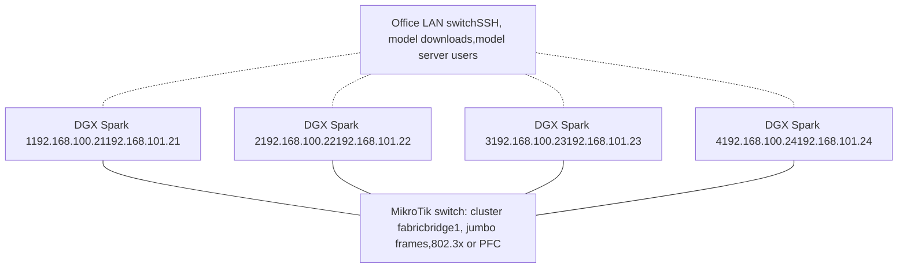

# NVIDIA DGX Spark clusters

> Plan an NVIDIA DGX Spark cluster with a MikroTik switch: choose the hardware, compare measured performance, and follow tested configurations to run a local coding assistant for a small team.

# NVIDIA DGX Spark clusters

NVIDIA DGX Spark is a desktop AI computer with 128 GB of memory. Connect several units into a cluster to run a model too large for one unit, or to share a local AI assistant with a team. A model that fits on one unit can also answer faster when several units share the work.

A MikroTik switch lets every unit communicate with every other unit through one high-speed cable per unit. The same network can distribute model files, carry other transfers while the model runs, and connect the units to a storage server or router if you leave ports available.

This page helps you choose the number of units and a switch, and shows what performance to expect. It then walks through two tested four-unit setups: a CRS504 at 100 Gbit/s per unit and a CRS804 at 200 Gbit/s per unit. Both lead to the same practical example: DeepSeek V4.1 Flash as a coding assistant for a small team, with the source code kept in the office.

## Plan the cluster

Choose enough units to hold the model you want to run, then decide how to share them among users. The model server is the software that runs the model and answers requests; one server can use several units.

| Goal | Units | Switch example | Model server |
| :-- | :-- | :-- | :-- |
| Run a model too large for one unit | 2 to 4, depending on the model's memory needs | CRS504 or CRS804 | One server across all units |
| Give each user faster answers | 4 | CRS504 or CRS804 | One server across all four units |
| Serve more users than one server runs at a time | 4 | CRS504 or CRS804 | Two servers of two units each, for a model that fits two units |
| Copy large files between units while the model runs | 4 | CRS804 | Keep the model's traffic separate from bulk traffic |

For example, DeepSeek V4 Flash (167 GB) runs on two units. The larger DeepSeek V4.1 Flash (510 GB) does not fit on two; the walkthrough uses four units, with a copy of the model on each unit's disk.

For models that fit on two units, four units can run either one shared server or two separate servers. Which arrangement serves more users depends on the model and the server settings. The examples under "Recommended settings" explain that choice.

## Choose a switch

The CRS504 provides a simple four-unit setup for running a model on a dedicated network. The CRS804 provides 200 Gbit/s links and is used here for the example that shares the network with bulk transfers.

The configurations and performance results on this page use four units on a CRS504 or CRS804. The table lists how many units each switch can connect at the stated link speed.

| Switch | Ports for the units | Units connected at the listed speed | Link per unit |
| :-- | :-- | :-- | :-- |
| CRS504-4XQ-IN | 4 × 100G QSFP28 | 4 | 100 Gbit/s |
| CRS520-4XS-16XQ-RM | 16 × 100G QSFP28 | 16 | 100 Gbit/s |
| CRS804-4DDQ-hRM | 4 × 400G QSFP56-DD | 4, or 8 with 400G to 2 × 200G breakout cables | 200 Gbit/s |
| CRS812-8DS-2DQ-2DDQ-RM | 2 × 400G QSFP56-DD, 2 × 200G QSFP56 | 6, with breakout cables on the 400G ports | 200 Gbit/s |

- **Text generation:** the tested 100 and 200 Gbit/s clusters generated text at similar speeds. A faster network link does not by itself mean faster answers.
- **Network capacity:** a 200 Gbit/s link gives twice the capacity for model loading, storage traffic and long prompts. How much faster a task finishes depends on the workload. NVIDIA's switched DGX Spark setup specifies 200 Gbit/s per unit.
- **Other devices:** count a port for a storage server or a link to another switch. Four units use all four QSFP ports of a CRS504.
- **Cables:** each four-unit example uses four QSFP cables, one from each unit to the switch. The CRS504 setup uses 100 Gbit/s direct attach copper (DAC) cables; the CRS804 setup uses 200 Gbit/s links. The breakout options in the table split one 400 Gbit/s switch port into two 200 Gbit/s connections, one per unit. Also allow for each unit's separate Ethernet connection to the office network and access to the switch's management port.
- **Shared traffic:** both the CRS504 and CRS804 support Priority-based Flow Control (PFC) to protect model traffic when it shares a network with bulk transfers. The shared-network example uses the CRS804; the CRS504 example uses a simpler configuration for a dedicated network. The CRS812 has the same switch chip as the CRS804 (98DX7335). See [QoS device support](../quality-of-service#qos-device-support) for support across switch models.

## What performance to expect

The DeepSeek V4.1 Flash example runs one model server across four units. Its measured text generation speed is 75 to 80 tokens per second (tok/s) for one user, about 40 tok/s per user for four users, and about 26 tok/s per user for eight users. These rates include the model's thinking tokens, so they do not tell you how soon a complete answer arrives.

The model can generate internal reasoning ("thinking") before it answers. In the coding sessions, turning thinking off shortened the wait substantially:

| Coding session | Complete answer with thinking on, median | Complete answer with thinking off, median |
| :-- | --: | --: |
| One user | 18–19 s | 4–7 s |
| Three users at the same time | 30–31 s | 9 s |

These medians cover multiple turns of each session. The first turn takes longer because the server must read the new prompt: in the single-user sessions, the first token arrived after 9 to 10 s on the first turn and about 1 s on later turns. Very long prompts take longer and can slow the replies to other users.

Both switches delivered similar results with the example's settings. The "Example results" section gives the full measurements and test conditions; other models, prompts and settings give different results.

## Before you begin

Each DGX Spark has a ConnectX-7 network adapter with two QSFP ports. The cluster network is also called the fabric; the examples keep it separate from the office network.

- Each unit has one cable from its first QSFP port to the switch.
- The two network interfaces of that port have IP addresses in NetworkManager profiles, as in the following table. NVIDIA's cluster setup creates such profiles (see the [DGX Spark playbooks](https://build.nvidia.com/spark)).
- Management traffic (SSH, model downloads, users of the model server) uses another network port of the units, not the cluster fabric.
- The commands on this page use `nmcli`, `mlnx_qos`, `ethtool`, `show_gids` and `ib_write_bw`. DGX OS includes them.
- The switch's QSFP ports carry no other configuration, and you reach the switch through its management port.

| Unit | `enp1s0f0np0` (RDMA device `rocep1s0f0`) | `enP2p1s0f0np0` (RDMA device `roceP2p1s0f0`) |
| :-- | :-- | :-- |
| 1 | 192.168.100.21/24 | 192.168.101.21/24 |
| 2 | 192.168.100.22/24 | 192.168.101.22/24 |
| 3 | 192.168.100.23/24 | 192.168.101.23/24 |
| 4 | 192.168.100.24/24 | 192.168.101.24/24 |

The two interfaces are two PCIe functions of the same QSFP port, so one cable carries both. Each interface reaches about 100 Gbit/s. On a 100 Gbit/s link, the first interface alone reaches the link rate. On a 200 Gbit/s link, the application must use both.



The solid lines are the QSFP cables of the cluster fabric. The dotted lines are the units' Ethernet connections to the office network, through the office's own switch. The two networks stay separate: the fabric carries only traffic between the units.

### How the cluster network works

The units exchange data with remote direct memory access (RDMA) over Converged Ethernet version 2 (RoCEv2). RoCEv2 recovers lost packets, but slowly: on a network that drops packets under load, its throughput falls sharply. Both configurations use jumbo frames and flow control to prevent RDMA packet loss.

802.3x flow control pauses all traffic on a link, which suits a fabric that carries only the cluster's inference traffic. PFC pauses only the lossless traffic class, so bulk transfers in another class do not pause the inference traffic. The CRS504 example uses 802.3x for a simpler configuration; the CRS804 example uses PFC to carry both types of traffic.

## Connect four units to a CRS504 at 100 Gbit/s

A team runs a coding assistant on four DGX Spark units, with one 100 Gbit/s cable from each unit to a CRS504-4XQ. The fabric carries only the cluster's inference traffic. The configuration gives the units jumbo frames and 802.3x flow control: when several units send to one at the same time, the switch pauses the senders instead of dropping their packets. Flow control pauses the whole link, so keep storage and other bulk transfers off this fabric, or use PFC as in the CRS804 example.

### Configure the switch

Add the four ports that connect to the units to one bridge. Hardware offloading forwards their traffic at line rate. Keep all ports of the cluster in this one bridge: on this switch, only one bridge is hardware offloaded (see [Bridges on a single switch chip](./layer2-misconfiguration#bridges-on-a-single-switch-chip)). If the switch already has a bridge with these ports, skip this step.

```routeros
/interface/bridge/add name=bridge1
/interface/bridge/port
add bridge=bridge1 interface=qsfp28-1-1
add bridge=bridge1 interface=qsfp28-2-1
add bridge=bridge1 interface=qsfp28-3-1
add bridge=bridge1 interface=qsfp28-4-1
```

Set the L2MTU for jumbo frames, and turn on Reed-Solomon forward error correction (RS-FEC) and 802.3x flow control on the four ports:

```routeros
/interface/ethernet
set [find name~"qsfp28-"] l2mtu=9500
set [find name~"qsfp28-.-1"] fec-mode=fec91 \
    rx-flow-control=on tx-flow-control=on
```

:::note
A change of `l2mtu`, `fec-mode` or flow control restarts the link for a few seconds. Make the change before you start the model servers.
:::

### Configure the units

A DGX Spark sends and obeys 802.3x pause frames by default. Set the MTU to 9000 on both network interfaces of the connected port. The commands set it in the NetworkManager profile of each interface, so that it stays after a restart, and bind each profile to its interface:

```bash
for i in enp1s0f0np0 enP2p1s0f0np0; do
  c=$(nmcli -g GENERAL.CONNECTION device show $i)
  sudo nmcli connection modify "$c" 802-3-ethernet.mtu 9000 \
      connection.interface-name $i
  sudo ip link set $i mtu 9000
done
```

At 100 Gbit/s, the model server uses the first interface: pass `NCCL_IB_HCA=rocep1s0f0` to its container.

### Check the network

From every unit, send a full-size packet to both addresses of each other unit. The ping fails when a port or a unit on that path has a smaller MTU, so one working pair does not prove the others. For example, from unit 1 to unit 2:

```bash
ping -c 3 -M do -s 8972 192.168.100.22
ping -c 3 -M do -s 8972 192.168.101.22
```

On the switch, check that the four bridge ports have the `H` (hardware offloaded) flag:

```routeros
/interface/bridge/port/print
```

Pause frames appear only under congestion. With no traffic, or with one sender for each receiver, the pause counters stay at 0. To see flow control work, let units 2 and 3 send to unit 1 at the same time, so that unit 1's port receives twice its link rate.

1. Reset the counters on the switch:

   ```routeros
   /interface/ethernet/reset-counters [find name~"qsfp28-.-1"]
   ```

2. On each unit, find the RoCEv2 GID index of `rocep1s0f0`: the line of `show_gids rocep1s0f0` with `v2` and the unit's IPv4 address. Use it as `<GID>` in the following commands.
3. On unit 1, start one receiver for each sender:

   ```bash
   ib_write_bw -d rocep1s0f0 -x <GID> -F --report_gbits \
       -s 65536 -q 4 -D 10 -p 18601 &
   ib_write_bw -d rocep1s0f0 -x <GID> -F --report_gbits \
       -s 65536 -q 4 -D 10 -p 18602
   ```

4. On units 2 and 3, start the senders at the same time, with port 18601 on unit 2 and 18602 on unit 3:

   ```bash
   ib_write_bw -d rocep1s0f0 -x <GID> -F --report_gbits \
       -s 65536 -q 4 -D 10 -p 18601 192.168.100.21
   ```

5. Read the counters on the switch:

   ```routeros
   /interface/ethernet/print stats where name~"qsfp28-.-1"
   ```

On a working configuration, the two receivers on unit 1 together report about 98 Gbit/s, `tx-pause` grows on the ports of units 2 and 3, and `tx-drop-packet` and `rx-fcs-error` stay at 0 on all four ports.

Read the drop counters of unit 1's network adapter before and after the check. They do not grow:

```bash
ethtool -S enp1s0f0np0 | grep -e rx_discards_phy -e rx_out_of_buffer
```

## Connect four units to a CRS804 at 200 Gbit/s with PFC

The same team also copies model files between the units and runs a second job on the cluster. The four units connect to a CRS804-4DDQ, one 200 Gbit/s cable each. PFC keeps the inference traffic lossless in traffic class 3, and its thresholds make the switch pause only the units that send to a busy port, so a transfer into one unit does not stop the inference traffic of the others. Leave the bulk transfers in the default class: the switch drops them under congestion, their protocols recover, and text generation keeps most of its speed. Bulk RDMA traffic that must not lose packets can share traffic class 3, at a larger cost to text generation (see [Bulk transfers and text generation](#bulk-transfers-and-text-generation)). Both still share the link bandwidth and the units' network adapters. It costs a QoS configuration on the switch and on each unit, and the model servers must mark their RDMA traffic.

PFC works in both directions. The switch pauses the units that send to a busy port, and a receiving unit pauses the switch: each of its two network interfaces takes about 100 Gbit/s, so it cannot always take a 200 Gbit/s burst on one interface. Without PFC, for example with ECN alone, the receiving unit drops packets in its network adapter, and bulk RDMA traffic in traffic class 3 slows text generation to a few tokens per second. Keep PFC on, also when you add ECN.

The CRS804 does not send 802.3x pause frames. Use PFC on it.

Other devices on the fabric bridge, such as a router or a storage server, send their traffic in the default class. A few Gbit/s of such traffic has no measurable effect on text generation. Without IGMP snooping, the bridge floods multicast from these devices to every unit and to the switch CPU, and a multicast stream of several Gbit/s keeps the switch CPU busy (see [Bridge IGMP/MLD snooping](./bridge-igmp-mld-snooping)).

### Configure the switch

Add the four ports to one bridge and set the L2MTU for jumbo frames, as on the CRS504:

```routeros
/interface/bridge/add name=bridge1
/interface/bridge/port
add bridge=bridge1 interface=qsfp56-dd-1-1
add bridge=bridge1 interface=qsfp56-dd-2-1
add bridge=bridge1 interface=qsfp56-dd-3-1
add bridge=bridge1 interface=qsfp56-dd-4-1
/interface/ethernet
set [find name~"qsfp56-dd-"] l2mtu=9500
```

Map RoCEv2 traffic (DSCP 26) to traffic class 3 and congestion notification packets (DSCP 48) to traffic class 6. Create a PFC profile for traffic class 3 with a pause threshold of 128 KiB and a resume threshold of 64 KiB, and apply it to the four ports. The ports trust the DSCP value of the packets (`trust-l3=keep`).

```routeros
/interface/ethernet/switch/qos/profile
add dscp=26 name=roce traffic-class=3
add dscp=48 name=cnp traffic-class=6
/interface/ethernet/switch/qos/priority-flow-control
add name=pfc-tc3 rx=yes traffic-class=3 tx=yes \
    pause-threshold=128KiB resume-threshold=64KiB
/interface/ethernet/switch/qos/port
set [find name~"qsfp56-dd-.-1"] pfc=pfc-tc3 trust-l3=keep
```

With these thresholds, the switch pauses a unit that sends to a busy port when that unit's packets fill 128 KiB of the switch's buffer, and lets it send again when they drop 64 KiB below that. The other units keep sending. With the default `auto` thresholds, the switch pauses all four ports when its shared lossless buffer fills, and one transfer into one unit stops the inference traffic of every unit. PFC receive also needs the egress rate of queue 3, which the switch sets on these ports by itself.

### Configure the units

Set the MTU to 9000 on both interfaces as for the CRS504. Then make each unit trust the DSCP value, run PFC on priority 3 and stop 802.3x pause frames. A unit maps DSCP 26 to priority 3.

```bash
for i in enp1s0f0np0 enP2p1s0f0np0; do
  sudo mlnx_qos -i $i --trust=dscp --pfc=0,0,0,1,0,0,0,0
  sudo ethtool -A $i rx off tx off
done
```

These settings do not stay after a restart of the unit. Run the loop again after each start, and check that `mlnx_qos -i enp1s0f0np0` prints `Priority trust state: dscp` and, in its PFC section, `enabled 0 0 0 1 0 0 0 0`.

### Mark the traffic and use both interfaces

Pass these settings to the model server's container on every unit, for example with `docker run -e`:

| Setting | Value | What it does |
| :-- | :-- | :-- |
| `NCCL_IB_HCA` | `rocep1s0f0,roceP2p1s0f0` | NCCL uses both RDMA devices of the port. |
| `NCCL_IB_MERGE_NICS` | `1` | NCCL combines the two devices into one 200 Gbit/s connection. |
| `NCCL_IB_TC` | `106` | NCCL marks its RDMA traffic with DSCP 26. |
| `B12X_ROCE_TRAFFIC_CLASS` | `106` | NVIDIA's RDMA all-reduce in the vLLM image of the DeepSeek V4.1 Flash example marks its traffic the same way. |

The value 106 is DSCP 26 with the ECN-capable bits set, which the switch maps to traffic class 3. Other RDMA software has its own traffic class setting; set it to 106 too. Leave bulk traffic unmarked.

### Check the network

Check jumbo frames and the bridge as for the CRS504. Then print the QoS port settings:

```routeros
/interface/ethernet/switch/qos/port/print
```

A `;;;` comment line under a port names a setting that the port is missing.

Run the congestion check of the CRS504 example with the port names `qsfp56-dd-.-1`, and mark the test traffic for the lossless class: add `--tclass=106 -S 3` to each `ib_write_bw` command. Run it on both interfaces at the same time, with `roceP2p1s0f0`, its own GID index, the 192.168.101.x addresses and ports 18603 and 18604 for the second pair.

On a working configuration, the receivers on unit 1 together report about 196 Gbit/s, `tx-pause` grows on the ports of units 2 and 3 and stays at 0 on the ports of units 1 and 4, and `tx-drop-queue3-packet` stays at 0. `rx-pause` can also grow on the port of unit 1: unit 1 pauses the switch when one of its interfaces receives faster than it can take. On units 2 and 3, `rx_prio3_pause` grows:

```bash
ethtool -S enp1s0f0np0 | grep prio3_pause
```

While the senders run, the switch's lossless buffer holds a few hundred KiB, far below its capacity:

```routeros
/interface/ethernet/switch/qos/monitor once
```

`lossless-pool-byte-use` near half of `lossless-pool-byte-cap`, with `tx-pause` on all four ports, means the PFC profile uses `auto` thresholds.

## Recommended settings

### Network settings

The two switch examples apply these settings:

| Choice | Recommended setting | Reason |
| :-- | :-- | :-- |
| Flow control on a fabric with only the cluster's inference traffic | 802.3x, as in the CRS504 example | The switch drops no packets, with the least configuration. |
| Flow control on a CRS804, or on a fabric shared with bulk transfers | PFC on traffic class 3 with a 128 KiB pause threshold and a 64 KiB resume threshold | A transfer into one unit does not pause the inference traffic of the others. |
| Frame size | MTU 9000 on the units, `l2mtu=9500` on the switch | RDMA sends the same data in fewer, larger packets. |

### Model server settings for DeepSeek V4.1 Flash

These settings apply to the model and vLLM build used in the walkthrough, which applies them to the model server and client requests.

| Choice | Recommended setting | Reason |
| :-- | :-- | :-- |
| Model servers | One server across all four units | The model needs the memory of all four units. |
| Data exchange between the units | NVIDIA's RDMA all-reduce (`VLLM_ENABLE_ROCE_ALLREDUCE=1`) on the first interface | Text generation is about one sixth faster than with NCCL. |
| Speculative decoding | The model's own draft model with 5 draft tokens | It roughly doubles the speed for one user. 5 draft tokens also serve 8 to 16 users best. |
| Requests served at the same time | `--max-num-seqs 16` | Published recipes set 2 or 8, and further requests wait in a queue. Values of 8 and 16 give the same speed for up to 8 users. |
| Context cache | `--kv-cache-memory-bytes 6G` | Without the option, the cache takes all the GPU memory the model leaves. With a fixed 6 GiB, 18 to 20 GB stay free on every unit while the server reads long prompts, instead of 2 to 3 GB. |
| Prompts that wait | `--max-parallel-prefills auto --prefill-policy decode-aware` | The server reads several waiting prompts at the same time, a part of each in every step. A short request does not wait until another user's long prompt is read: behind a 90,000-token prompt, it starts after 3 s instead of 26 s. |
| Prompts that arrive while others receive text | `--prefill-schedule-interval 8` | The server reads prompts in every eighth step. The other users keep 33 to 47% of their speed instead of 5 to 10%. |
| Thinking | Set by each request: off for quick edits, with a thinking budget otherwise | With thinking on, most of the wait for an answer is thinking. |

### Cluster size and server layout

DeepSeek V4.1 Flash needs all four units in this example. For a model that fits on two units, the choice between one four-unit server and two two-unit servers depends on the workload and the server's request limit:

- For one user, a server on four units generated text about one and a half times faster than a server on two units in the tests.
- DeepSeek V4 Flash (167 GB) ran on two units at 54 tok/s for one user, and on four units at 82 tok/s. DeepSeek V4.1 Flash (510 GB) generates text about as fast on four units, and answers a coding question three to four times sooner because it thinks less.
- A 27-billion-parameter model gave the most answers in total from one four-unit server at 8 and 16 users, and from two two-unit servers at 32 users.
- With a limit of 8 simultaneous requests per server, 16 users of DeepSeek V4 Flash got more answers from two two-unit servers: on one server, 8 users waited in a queue. With the limit raised to 32, one four-unit server gave more answers.

## Run DeepSeek V4.1 Flash for a small team

A team of four developers wants a coding assistant that runs in the office and keeps the source code there. Four DGX Spark units on one of the networks of this page serve DeepSeek V4.1 Flash, and each developer connects a coding agent to it. Each developer gets 40 to 75 tok/s, depending on how many are active at once. The model needs the memory of all four units and 510 GB of disk space on each.

The steps use the vLLM image `eugr/spark-vllm-b12x:nightly-20261015`, the model checkpoint `DeepSeek-V4.1-Flash-1017` and Pi 0.87.

Prerequisites:

- The four units are connected, configured and checked as in the CRS504 or the CRS804 section.
- Each unit has 540 GB of free disk space.
- The commands use Docker with the NVIDIA Container Toolkit. DGX OS includes them. Your user is a member of the `docker` group.
- Your user on unit 1 reaches the other units with an SSH key.

### Get the image and the model

On every unit, download the model server image and create the model folder:

```bash
docker pull eugr/spark-vllm-b12x:nightly-20261015
sudo mkdir -p /opt/models
sudo chown $USER /opt/models
```

On unit 1, download the model with the `hf` tool of the image. If the download stops, run the command again: it continues where it stopped.

```bash
docker run --rm --network host -v /opt/models:/opt/models \
    --entrypoint hf eugr/spark-vllm-b12x:nightly-20261015 \
    download deepseek-ai/DeepSeek-V4.1-Flash-1017 \
    --revision 08c8657f02291e11b6f6b63e0e16014f8e748518 \
    --local-dir /opt/models/DeepSeek-V4.1-Flash-1017
```

Copy the model from unit 1 to the other units through the cluster fabric:

```bash
for u in 192.168.100.22 192.168.100.23 192.168.100.24; do
  rsync -a --exclude .cache \
      /opt/models/DeepSeek-V4.1-Flash-1017 $u:/opt/models/ &
done
wait
```

The download takes about 70 minutes on a 1 Gbit/s internet connection. The copy to the three other units takes about 20 minutes: SSH encryption limits its speed, not the link.

### Start the model server

On unit 1, create an API key. Clients send it with every request.

```bash
openssl rand -hex 24 > ~/dgx-spark.key
chmod 600 ~/dgx-spark.key
```

On each unit, create the file `~/start-vllm.sh`. It begins with three values of that unit:

| Unit | `RANK` | `IP` | `HEADLESS` |
| :-- | :-- | :-- | :-- |
| 1 | `0` | `192.168.100.21` | Empty |
| 2 | `1` | `192.168.100.22` | `--headless` |
| 3 | `2` | `192.168.100.23` | `--headless` |
| 4 | `3` | `192.168.100.24` | `--headless` |

For example, the file begins like this on unit 1, where `HEADLESS` stays empty:

```bash
RANK=0
IP=192.168.100.21
HEADLESS=
```

The rest of the file is the same on every unit. It finds the RoCEv2 GID index of the unit's first interface, and starts the server with the settings of the previous section.

```bash
[ -f ~/dgx-spark.key ] && export VLLM_API_KEY=$(cat ~/dgx-spark.key)
docker rm -f vllm > /dev/null 2>&1
GID=$(show_gids rocep1s0f0 | awk -v ip=$IP \
    '$5 == ip && $6 == "v2" {print $3}')
DRAFT='{"method":"dspark","num_speculative_tokens":5,
  "draft_tensor_parallel_size":4,"attention_backend":"B12X",
  "draft_sample_method":"probabilistic",
  "rejection_sample_method":"standard",
  "enable_adaptive_verification":true}'
docker run -d --name vllm --network host --ipc host \
    --privileged --shm-size=16g --ulimit memlock=-1 \
    --ulimit nofile=1048576:1048576 \
    --device nvidia.com/gpu=all --device /dev/infiniband \
    -v /opt/models:/opt/models -v $HOME/.cache:/root/.cache \
    -e VLLM_API_KEY -e VLLM_HOST_IP=$IP \
    -e VLLM_ENABLE_ROCE_ALLREDUCE=1 \
    -e VLLM_ROCE_ALLREDUCE_MAX_SIZE=2MB \
    -e VLLM_USE_V2_MODEL_RUNNER=1 \
    -e VLLM_USE_BREAKABLE_CUDAGRAPH=0 \
    -e VLLM_MXFP8_LM_HEAD=1 \
    -e VLLM_ENGINE_READY_TIMEOUT_S=3600 \
    -e B12X_COMPILE_WORKERS=4 -e CUTE_DSL_ARCH=sm_121a \
    -e B12X_ROCE_SPIN_LIMIT=1200000000 \
    -e B12X_ROCE_HCA=rocep1s0f0 -e B12X_ROCE_GID_INDEX=$GID \
    -e NCCL_IB_HCA=rocep1s0f0 -e NCCL_IB_ROCE_VERSION_NUM=2 \
    -e NCCL_IB_ADDR_RANGE=192.168.100.0/24 \
    -e NCCL_SOCKET_IFNAME=enp1s0f0np0 \
    -e GLOO_SOCKET_IFNAME=enp1s0f0np0 \
    --entrypoint vllm eugr/spark-vllm-b12x:nightly-20261015 \
    serve /opt/models/DeepSeek-V4.1-Flash-1017 \
    --host 0.0.0.0 --port 8000 \
    --served-model-name deepseek-v4.1-flash \
    --tensor-parallel-size 4 --nnodes 4 --node-rank $RANK \
    --master-addr 192.168.100.21 --master-port 29501 $HEADLESS \
    --dtype bfloat16 --load-format b12x --linear-backend b12x \
    --moe-backend b12x --attention-backend b12x \
    --tokenizer-mode deepseek_v41 \
    --reasoning-parser deepseek_v41 \
    --tool-call-parser deepseek_v41 --enable-auto-tool-choice \
    --limit-mm-per-prompt '{"image":1}' \
    --engram-config '{"cpu_offload":false,"table_memory":"disk"}' \
    --speculative-config "$DRAFT" \
    --block-size 256 --enable-prefix-caching \
    --enable-prompt-tokens-details --max-model-len auto \
    --max-num-seqs 16 --max-num-batched-tokens 4096 \
    --max-cudagraph-capture-size 96 \
    --gpu-memory-utilization 0.87 --kv-cache-memory-bytes 6G \
    --max-parallel-prefills auto --prefill-policy decode-aware \
    --prefill-schedule-interval 8
```

- `-e VLLM_API_KEY` passes the key of unit 1 to the server. The other units have no key file.
- Unit 1 serves the API on port 8000 of all its addresses. The API is plain HTTP: let only networks you trust reach the port.
- On the CRS804 configuration, also pass the four settings of the table under "Mark the traffic and use both interfaces", and set `NCCL_IB_ADDR_RANGE=192.168.100.0/23` so that the range has both networks.

Start the server on every unit, unit 1 first:

```bash
bash ~/start-vllm.sh
```

The first start takes 13 to 30 minutes: the server compiles and tunes its GPU code, and keeps the result in `~/.cache`. Later starts take about four minutes. On unit 1, wait until the server answers:

```bash
until curl -sf -o /dev/null localhost:8000/health; do
  sleep 10
done
```

To stop the server, run `docker rm -f vllm` on every unit.

### Check the server

On unit 1, ask a question with thinking off:

```bash
curl -s localhost:8000/v1/chat/completions \
    -H "Authorization: Bearer $(cat ~/dgx-spark.key)" \
    -H "Content-Type: application/json" \
    -d '{"model": "deepseek-v4.1-flash", "max_tokens": 300,
         "chat_template_kwargs": {"thinking": false},
         "messages": [{"role": "user", "content":
           "Reverse the words of a sentence in Python."}]}'
```

The reply is a JSON object with the answer in `choices[0].message.content` and the number of generated tokens in `usage.completion_tokens`. A request without the key gets HTTP 401.

### Connect the Pi coding agent

[Pi](https://pi.dev) is a coding agent for the terminal. Each developer installs it as its documentation describes, and then adds the cluster as a model provider.

Copy the API key from unit 1. In these commands, 192.168.88.21 is the address of unit 1 on the office network:

```bash
mkdir -p ~/.pi/agent
scp 192.168.88.21:dgx-spark.key ~/.pi/agent/dgx-spark.key
chmod 600 ~/.pi/agent/dgx-spark.key
```

Create the file `~/.pi/agent/models.json`. If the file exists, add the `dgx-spark` object to its `providers`.

```json
{
  "providers": {
    "dgx-spark": {
      "baseUrl": "http://192.168.88.21:8000/v1",
      "api": "openai-completions",
      "apiKey": "!cat ~/.pi/agent/dgx-spark.key",
      "compat": {
        "supportsStore": false,
        "supportsDeveloperRole": false,
        "supportsReasoningEffort": false,
        "supportsUsageInStreaming": true,
        "supportsStrictMode": false,
        "supportsLongCacheRetention": false,
        "maxTokensField": "max_tokens",
        "thinkingFormat": "chat-template",
        "chatTemplateKwargs": {
          "thinking": { "$var": "thinking.enabled" },
          "reasoning_effort": {
            "$var": "thinking.effort",
            "omitWhenOff": true
          }
        },
        "thinkingTokenBudgetField": "thinking_token_budget"
      },
      "models": [
        {
          "id": "deepseek-v4.1-flash",
          "name": "DeepSeek V4.1 Flash (DGX Spark cluster)",
          "reasoning": true,
          "thinkingLevelMap": {
            "minimal": "low",
            "low": "low",
            "medium": "high",
            "high": "high",
            "xhigh": "max",
            "max": "max"
          },
          "input": ["text", "image"],
          "contextWindow": 262144,
          "maxTokens": 32768,
          "cost": {
            "input": 0,
            "output": 0,
            "cacheRead": 0,
            "cacheWrite": 0
          }
        }
      ]
    }
  }
}
```

Start Pi with the model in the folder of a project:

```bash
pi --model dgx-spark/deepseek-v4.1-flash
```

- Pi reads the key from the file for each request, so the key is not in the configuration.
- The thinking levels of Pi map to the values the server accepts: `off` turns thinking off, `minimal` and `low` send `low`, `medium` and `high` send `high`, and `xhigh` sends `max`. With each level Pi also sends a thinking budget.
- The configuration limits a session to 262,144 tokens of context. The server accepts up to 1,048,576.

Other clients connect to the same address with the OpenAI chat completions API. The server also answers requests in the Anthropic format at `/v1/messages`. For any client:

- **Thinking is set by each request.** `"chat_template_kwargs": {"thinking": false}` turns it off, and so does `"reasoning_effort": "none"` for clients that only have the OpenAI field. With thinking on, the effort is `low`, `high`, `max` or a number from 1 to 100.
- **The server rejects the effort values `medium` and `minimal`** with HTTP 400. Some clients send `medium` by default.
- **A thinking budget caps the thinking.** `"thinking_token_budget": 2000` in a request stops the thinking after exactly 2,000 tokens. Without a budget, the model can use the whole output limit for thinking: open design questions with a 6,000-token limit got no answer. With a budget of 500 or 2,000 tokens, the answer followed. The answer still needs its own room in the output limit: one of six such answers was cut off at 6,000 tokens.
- **A client that sends no sampling settings gets DeepSeek's:** temperature 1.0 and top-p 1.0.

### Keep the server running

A unit keeps its network settings over a restart: the MTU, the addresses and 802.3x flow control. The model server does not start by itself, and it needs all four units. When one unit restarts, the server on the other three stops answering requests, although `/health` still returns 200. To recover, run `bash ~/start-vllm.sh` on all four units again.

A script on unit 1 does that by itself. Every minute it asks the server a one-token question. When three questions in a row get no answer, it waits until the other units are up, and starts the server on all four. Create the file `~/watch-vllm.sh` on unit 1:

```bash
#!/bin/bash
OTHERS="192.168.100.22 192.168.100.23 192.168.100.24"
ask() {
  curl -sf -m 60 -o /dev/null localhost:8000/v1/chat/completions \
      -H "Authorization: Bearer $(cat ~/dgx-spark.key)" \
      -H "Content-Type: application/json" \
      -d '{"model": "deepseek-v4.1-flash", "max_tokens": 1,
           "chat_template_kwargs": {"thinking": false},
           "messages": [{"role": "user", "content": "hi"}]}'
}
while true; do
  if ! ask && ! ask && ! ask; then
    echo "No answer from the server: starting it on all units"
    for u in $OTHERS; do
      until ssh -o BatchMode=yes -o ConnectTimeout=5 $u true; do
        sleep 5
      done
    done
    bash ~/start-vllm.sh
    for u in $OTHERS; do
      ssh -o BatchMode=yes $u 'bash ~/start-vllm.sh'
    done
    for i in $(seq 360); do
      curl -sf -o /dev/null localhost:8000/health && break
      sleep 10
    done
  fi
  sleep 60
done
```

Run the script as a service that starts with unit 1:

```bash
sudo tee /etc/systemd/system/vllm-watch.service > /dev/null <<EOF
[Unit]
Description=Start the model server when it does not answer
After=network-online.target docker.service
Wants=network-online.target

[Service]
User=$USER
ExecStart=/bin/bash $HOME/watch-vllm.sh
Restart=always

[Install]
WantedBy=multi-user.target
EOF
sudo systemctl enable --now vllm-watch
```

With the service on the CRS504 configuration, the server answered again 4 to 8 minutes after a restart of one unit, and about 5 minutes after a restart of all four. `journalctl -u vllm-watch` shows each time the script started the server. On the CRS804 configuration, also reapply the QoS loop from "Configure the units" after a unit restarts.

## Example results: DeepSeek V4.1 Flash

These results show what the server of the previous section delivers on the two networks of this page. Other models, settings and prompts give other numbers.

- **Benchmark prompts:** coding questions from NVIDIA's SPEED-Bench, thinking on, DeepSeek's sampling settings. One user: 10 prompts with up to 8,192 output tokens each. Several users: three prompts per user with up to 2,048 output tokens each.
- **Working sessions:** each user has a context of 36,000 tokens, a 6,000-token system prompt and 30,000 tokens of source code, and asks six questions. Every turn adds 2,000 tokens, and an answer has up to 4,000 tokens.

### Speed for each user

| Users at the same time | CRS504: speed per user | CRS504: first token | CRS804: speed per user | CRS804: first token |
| --: | --: | --: | --: | --: |
| 1 | 75 tok/s | 0.28 s | 80 tok/s | 0.30 s |
| 2 | 56 tok/s | 0.56 s | 58 tok/s | 0.55 s |
| 4 | 40 tok/s | 0.76 s | 40 tok/s | 0.67 s |
| 8 | 26 tok/s | 1.12 s | 26 tok/s | 0.98 s |

- **Speed per user** is the rate at which one request receives tokens after its first token. **First token** is the median time from the request to its first token.
- The rows for several users measure speed, not complete answers. Their limit of 2,048 output tokens is short for a model that thinks first: about a third of these requests ended before the answer began.
- Both clusters give similar speeds. The differences, up to 6% for one user, are what two starts of the same server differ by.

### Time to an answer

DeepSeek V4.1 Flash thinks before it answers, and a request can turn thinking off. That choice changes the wait for an answer more than any server setting. The ranges in the table are the results on the two switches.

| Working session | Thinking | Complete answer, median | Complete answer, 9 of 10 turns within | First token, first turn | First token, later turns |
| :-- | :-- | --: | --: | --: | --: |
| 1 user | On | 18–19 s | 27–29 s | 9–10 s | 1.0 s |
| 1 user | Off | 4–7 s | 12–13 s | 9–10 s | 1.0 s |
| 3 users at the same time | On | 30–31 s | 89–95 s | 23–24 s | 1.2–1.5 s |
| 3 users at the same time | Off | 9 s | 32–33 s | 20–23 s | 1.2–1.3 s |

- **The first turn of a session is slow, later turns are not.** The server reads a new prompt at about 3,400 tok/s: 2 s for 8,000 tokens, 9 s for 31,000 and 38 s for 125,000. It keeps what it has read, so on later turns it reads only the new part.
- **With thinking on, most of the wait is thinking.** The model writes 1,400 to 2,500 thinking tokens before a short answer, and the amount varies a lot from turn to turn. With thinking off, the answer starts with the first token.
- **Thinking can use the whole output limit.** In the sessions of three users with thinking on, 3 or 4 of the 18 turns ended at the 4,000-token limit with no answer. A thinking budget lower than the output limit prevents it.

### Long prompts on a shared server

| Situation | Recommended settings | Without them |
| :-- | --: | --: |
| First token of a short request, sent 3 s after another user's new 90,000-token prompt | 2.4–2.9 s | 26 s |
| Speed of the other users while the server reads two new 140,000-token prompts | 33–47% | 5–10% |
| Free memory on each unit after long prompts | 18–20 GB | 2–3 GB |

- A single new prompt of 90,000 tokens gets its first token after 26 to 28 s.
- Two long prompts that arrive together take longer: 2 to 3.5 minutes each for 130,000 to 240,000 tokens.
- A new session that starts while the server reads two long prompts waits 40 to 65 s for its first token. A turn of a session in progress waits 5 to 7 s.
- The server stays stable under this load. In a 45-minute run, three users worked in sessions and two new prompts of 130,000 to 240,000 tokens arrived every four minutes. All 131 turns and all 20 long prompts completed without an error, no reply paused for more than 1.7 s, and 18 to 20 GB of memory stayed free on every unit. In 6 of the turns, the thinking used the whole 4,000-token limit.

## Troubleshoot

- **The full-size ping fails:** a switch port has an `l2mtu` lower than 9000, or a unit has a different MTU.
- **The pause counters stay at 0:** without congestion this is expected. Run the congestion check.
- **`rx-fcs-error` grows on a 100 Gbit/s port:** set `fec-mode=fec91` on that port.
- **A 200 Gbit/s link carries only about 100 Gbit/s:** the application uses one interface. Give it both RDMA devices (`NCCL_IB_HCA`, `NCCL_IB_MERGE_NICS`).
- **NCCL finds no RoCE device after a link restart:** check with `ip -br addr` that each address is on its own interface. A NetworkManager profile that is not bound to its interface can come up on the other interface of the port; the MTU commands bind each profile.
- **`tx-drop-queue3-packet` grows on the CRS804:** check that the units trust DSCP and run PFC on priority 3 (`mlnx_qos -i enp1s0f0np0`), and that the QoS port print shows no comment line.
- **`tx-pause` grows on all four ports in the congestion check:** the PFC profile uses `auto` thresholds. Set the thresholds of the CRS804 example.
- **Text generation stops while a large transfer runs:** the transfer is marked for the lossless class and the PFC profile uses `auto` thresholds. Set the thresholds of the CRS804 example, or leave bulk traffic unmarked.
- **The first start of the model server takes half an hour:** the server compiles and tunes its GPU code on the first start, and keeps the result in `~/.cache` for later starts.
- **A client gets HTTP 400 from the model server:** the client sends the thinking effort `medium` or `minimal`. Set the effort to `low`, `high` or `max`, or map the levels of the client as in the Pi configuration.
- **A reply has thinking and no answer:** the thinking used the whole output limit of the request. Set a thinking budget, raise the output limit, or turn thinking off for the request.
- **The first answer of a session takes many seconds:** the server reads a new prompt at about 3,400 tok/s, and keeps what it has read for the later turns.
- **Text arrives slower while another user sends a long prompt:** the server reads the prompt between the steps of text generation. With the recommended settings, the other users keep 33 to 47% of their speed.
- **A client shows about 25 tok/s for one user:** the client counts stream chunks as tokens. The server sends one chunk with 3 to 4 tokens for each step. The token counts in `usage` at the end of a reply are exact.

## Technical details

### Traffic classes

| Traffic | DSCP | IP traffic class | Switch traffic class | Unit priority |
| :-- | --: | --: | --: | --: |
| RoCEv2 data | 26 | 106 | 3 | 3 |
| Congestion notification packets | 48 | 192 | 6 | 6 |
| Other traffic | 0 | 0 | default | 0 |

The IP traffic class is the whole IP header byte: DSCP 26 shifted by two bits (104) plus the ECN-capable bits (2).

### PFC thresholds

The switch counts the packets waiting in its buffer per ingress port, and pauses a port when its count reaches the pause threshold. The CRS804 measurements:

- Pause thresholds from 32 to 512 KiB all paused only the units that sent to the busy port, dropped no packets and kept the receivers at line rate.
- With the 128 KiB threshold, each paused unit held about 180 KiB: the threshold plus the packets still on their way after the pause. Two units sending to one port used about 360 KiB of the 3.9 MiB lossless buffer.
- At 1 MiB, two senders reached the shared limit, and the switch paused all ports, as with `auto`. Keep the pause threshold at 512 KiB or lower.
- Resume thresholds of 16 to 112 KiB below a 128 KiB pause threshold made no measurable difference.
- ECN on queue 3 (`ecn=yes` in `/interface/ethernet/switch/qos/tx-manager/queue`) can stay on with these thresholds. The switch marked no packets in the tests: PFC keeps the queues shorter than the marking level. It cost no throughput either.

### Bulk transfers and text generation

Units 3 and 4 sent bulk RDMA traffic into unit 1 at about 200 Gbit/s, while a 27-billion-parameter model on all four units generated text for one and for eight users (CRS804 configuration, NVIDIA's RDMA all-reduce, speculative decoding). The table shows the text generation speed as a share of the speed without the transfer.

| Bulk traffic | Flow control | One user | Eight users | Bulk packets lost |
| :-- | :-- | --: | --: | :-- |
| Unmarked (default class) | PFC | 92% | 67% | Yes, recovered by the senders |
| Marked (traffic class 3) | PFC, thresholds of the CRS804 example | 89% | 55% | None |
| Marked (traffic class 3) | PFC, `auto` thresholds | Under 1% | Under 1% | None |
| Marked (traffic class 3) | ECN, no PFC | 9% | 2% | Some |

- Unmarked bulk traffic leaves the most speed to text generation. The senders resend what the switch drops.
- Marked bulk traffic loses nothing. The switch pauses units 3 and 4, and their inference traffic waits behind their own bulk traffic, so text generation for several users slows down more.
- With `auto` thresholds, the switch pauses all four ports and text generation stops.
- With ECN alone, the units slow down the inference traffic together with the bulk traffic.

### Network load of a model server

The vLLM example uses NVIDIA's RDMA all-reduce, which requires each unit to communicate directly with every other unit over the cluster network. The switch provides that connectivity through one cable per unit. In the tests, NVIDIA's RDMA all-reduce generated text about one sixth faster than NCCL.

A model server split across units exchanges many small messages for each generated token. The traffic stays low: on average a few Gbit/s per unit for one user, and less than 40 Gbit/s per unit for 16 users with speculative decoding. RDMA latency between two units through the switch is under 3 µs, which is a small part of the time each token takes. Link speed and switch latency therefore have little effect on text generation speed. Model loading and storage use the full link.

The four-unit CRS504 and CRS804 clusters generated text with DeepSeek V4 Flash and DeepSeek V4.1 Flash at speeds within about 6% of each other. Two starts of the same model server differ by as much.

Long prompts send more: DeepSeek V4.1 Flash with the settings of the example sends 18 to 20 Gbit/s per unit while it reads a 100,000-token prompt. Neither a 100 Gbit/s link nor the disk limits that speed: the disk of each unit works at 3 to 4% of its capacity.

With these settings, the model server reads long prompts at a similar speed on both clusters. With prompt batches four times larger (`--max-num-batched-tokens 16384`), the 200 Gbit/s cluster read long prompts 9 to 16% faster than the 100 Gbit/s cluster. That setting suits a server that mostly reads long prompts: with several users, it pauses the text of the others for 4 to 7 s.

### DeepSeek V4.1 Flash on four units

- **Memory:** each unit keeps 74 GiB of the model's weights in GPU memory. The model's lookup tables, 203 GB, stay on disk, and each unit reads them from its own copy. That is why every unit stores the whole checkpoint.
- **Two units cannot hold the model:** without the lookup tables its weights are 307 GB, more than the 256 GB of two units.
- **Speculative decoding:** in each step, the draft model proposes 5 tokens and the model keeps the ones it agrees with, 3 to 4 on average. One user gets about 23 steps per second. Without the draft model, the same server generates 44 tok/s for one user.
- **Stream chunks:** the server sends one chunk for each step, with all the tokens of that step. A client that counts chunks as tokens shows a third to a quarter of the real speed.
- **Start-up:** the first start compiles and tunes the GPU code for the chosen settings. A change of `--max-num-seqs` or of the number of draft tokens tunes again, for several minutes.

### LLDP and DCBX

With `lldp-dcbx=yes`, the default, the switch announces its PFC, ETS and RoCEv2 application priority settings to the units over LLDP. Set the QoS of the units by hand, as in the CRS804 example.

## Read more

- [Quality of Service](../quality-of-service)
- [Bridges on a single switch chip](./layer2-misconfiguration#bridges-on-a-single-switch-chip)
- [MTU in RouterOS](../../hardware/mtu-in-routeros)

For all properties, see the CLI reference for [`/interface/ethernet/switch/qos/priority-flow-control`](../../cli-reference/interface/ethernet/switch/qos/priority-flow-control), [`/interface/ethernet/switch/qos/port`](../../cli-reference/interface/ethernet/switch/qos/port/) and [`/interface/ethernet/switch/qos/profile`](../../cli-reference/interface/ethernet/switch/qos/profile).
