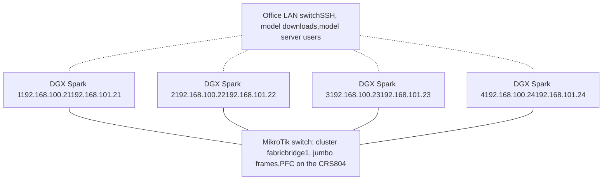

# NVIDIA DGX Spark clusters

> Plan an NVIDIA DGX Spark cluster with a MikroTik switch: choose the hardware, see what performance to expect, and follow example configurations to run a local coding assistant for a small team.

# NVIDIA DGX Spark clusters

NVIDIA DGX Spark is a desktop AI computer with 128 GB of memory. Connect several units into a cluster to run a model too large for one unit, or to share a local AI assistant with a team. A model that fits on one unit can also answer faster when several units share the work.

A MikroTik switch configured as on this page runs a model across several units as fast as direct cables between the units, and adds what direct cables cannot. Every unit reaches every other unit through one high-speed cable, so you can add units or split them into separate model servers without recabling. The same network can distribute model files, carry other transfers while the model runs, and connect the units to a storage server or router if you leave ports available.

This page helps you choose the number of units and a switch, and shows what performance to expect. It then walks through two four-unit setups: a CRS504 at 100 Gbit/s per unit and a CRS804 at 200 Gbit/s per unit. Both lead to the same practical example: DeepSeek V4.1 Flash as a coding assistant for a small team, with the source code kept in the office. A later section shows a faster model server for the same example, with a more complex setup.

## Plan the cluster

Choose enough units to hold the model you want to run, then decide how to share them among users. The model server is the software that runs the model and answers requests; one server can use several units.

| Goal | Units | Switch example | Model server |
| :-- | :-- | :-- | :-- |
| Run a model too large for one unit | 2 to 4, depending on the model's memory needs | CRS504 or CRS804 | One server across all units |
| Faster replies for one or a few users | 4 | CRS504 or CRS804 | One server across all four units |
| Increase total throughput with many users | 4 | CRS504 or CRS804 | Consider two servers of two units each, for a model that fits two units |
| Copy large files between units while the model runs | 4 | CRS804 | Keep the model's traffic separate from bulk traffic |

For example, DeepSeek V4 Flash (167 GB) runs on two units. The larger DeepSeek V4.1 Flash (510 GB) does not fit on two; the walkthrough uses four units, with a copy of the model on each unit's disk.

### Cluster size and server layout

For a model that fits on two units, four units can run either one shared server or two separate servers:

- One four-unit server can give faster replies to individual users. For example, DeepSeek V4 Flash generates about 54 tok/s for one user on two units and 82 tok/s on four.
- With many simultaneous requests, two two-unit servers can generate more text in total. The point at which this helps depends on the model, prompt lengths and server settings; compare both layouts with your workload.
- Check the server's request limit (`--max-num-seqs`) before deciding to split the cluster. Requests beyond this limit wait in a queue. Raising the limit can help a shared server serve more users, provided it has enough memory for their contexts.

## Choose a switch

The CRS504 suits four units on a network that carries only the cluster's traffic. The CRS804 gives each unit 200 Gbit/s and suits a network that also carries bulk transfers.

The examples on this page use four units on a CRS504 or CRS804. The table lists how many units each switch connects at the stated link speed.

| Switch | Ports for the units | Units connected at the listed speed | Link per unit |
| :-- | :-- | :-- | :-- |
| CRS504-4XQ-IN | 4 × 100G QSFP28 | 4 | 100 Gbit/s |
| CRS520-4XS-16XQ-RM | 16 × 100G QSFP28 | 16 | 100 Gbit/s |
| CRS804-4DDQ-hRM | 4 × 400G QSFP56-DD | 4, or 8 with 400G to 2 × 200G breakout cables | 200 Gbit/s |
| CRS812-8DS-2DQ-2DDQ-RM | 2 × 400G QSFP56-DD, 2 × 200G QSFP56 | 6, with breakout cables on the 400G ports | 200 Gbit/s |

- **Text generation:** the walkthrough's model server runs at similar speeds at 100 and 200 Gbit/s. A faster network link does not by itself mean faster answers. The faster [spark-ds41f](#faster-deepseek-v41-flash-with-spark-ds41f) server reads long prompts about 13% faster at 200 Gbit/s, and serves 16 requests at the same time 8 to 13% faster.
- **Network capacity:** a 200 Gbit/s link gives twice the capacity for model loading, storage traffic and long prompts. How much faster a task finishes depends on the workload. NVIDIA's switched DGX Spark setup specifies 200 Gbit/s per unit.
- **Other devices:** count a port for a storage server or a link to another switch. Four units use all four QSFP ports of a CRS504.
- **Cables:** one QSFP cable from each unit to the switch, at the speed of the switch port (see [Cables and links](#cables-and-links)). The breakout options in the table split one 400 Gbit/s switch port into two 200 Gbit/s connections, one per unit. Also allow for each unit's separate Ethernet connection to the office network and access to the switch's management port.
- **Shared traffic:** both the CRS504 and CRS804 support Priority-based Flow Control (PFC), which protects model traffic on a network shared with bulk transfers. A 100 Gbit/s network for the cluster alone needs no flow control, as in the CRS504 example. The CRS804 example uses PFC. The CRS812 has the same switch chip as the CRS804 (98DX7335). See [QoS device support](../quality-of-service#qos-device-support) for support across switch models.

## What performance to expect

These figures are examples for the model and settings shown; performance varies with prompt length, concurrent requests and reuse of cached context.

The DeepSeek V4.1 Flash example runs one model server across four units. It generates text at 75 to 80 tokens per second (tok/s) for one user, about 40 tok/s per user for four users, and about 26 tok/s per user for eight users. These rates include the model's thinking tokens, so they do not tell you how soon a complete answer arrives.

The model can generate internal reasoning ("thinking") before it answers. Turning thinking off shortens the wait for a complete answer:

| Coding session | Complete answer with thinking on, median | Complete answer with thinking off, median |
| :-- | --: | --: |
| One user | 18–19 s | 4–7 s |
| Three users at the same time | 30–31 s | 9 s |

The first turn takes longer because the server must read the new prompt. For one user with 30,000 tokens of source code, the first token arrives after about 9 to 10 s. Later turns reuse the cached context and start after about 1 s. Very long prompts take longer and can slow the replies to other users.

Both switch configurations give similar results for this example. The "Example results" section has more detail.

## Before you begin

Each DGX Spark has a ConnectX-7 network adapter with two QSFP ports. The cluster network is also called the fabric; the examples keep it separate from the office network.

- Each unit has one cable from its first QSFP port, the one with the interfaces `enp1s0f0np0` and `enP2p1s0f0np0`, to the switch.
- Both network interfaces of the connected port have persistent IPv4 addresses in NetworkManager profiles.
- Management traffic (SSH, model downloads, users of the model server) uses another network port of the units, not the cluster fabric.
- The commands on this page use `nmcli`, `mlnx_qos`, `ethtool`, `show_gids` and `ib_write_bw`. DGX OS includes them.
- The switch's QSFP ports carry no other configuration, and you reach the switch through its management port.

For fresh units, follow NVIDIA's [manual cluster setup](https://build.nvidia.com/spark/connect-multiple-sparks/advance) and choose a switched topology. Create the bridge described in the switch example before running NVIDIA's setup helper. The following table shows the addresses used throughout this page. If your setup assigns different addresses, substitute them in the network checks, model-copy commands and server scripts, including their subnet ranges.

| Unit | `enp1s0f0np0` (RDMA device `rocep1s0f0`) | `enP2p1s0f0np0` (RDMA device `roceP2p1s0f0`) |
| :-- | :-- | :-- |
| 1 | 192.168.100.21/24 | 192.168.101.21/24 |
| 2 | 192.168.100.22/24 | 192.168.101.22/24 |
| 3 | 192.168.100.23/24 | 192.168.101.23/24 |
| 4 | 192.168.100.24/24 | 192.168.101.24/24 |

The two interfaces are two PCIe functions of the same QSFP port, so one cable carries both. Each interface reaches about 100 Gbit/s. On a 100 Gbit/s link, the first interface alone reaches the link rate. On a 200 Gbit/s link, the application must use both.



The solid lines are the QSFP cables of the cluster fabric. The dotted lines are the units' Ethernet connections to the office network, through the office's own switch. The two networks stay separate: the fabric carries only traffic between the units.

### Cables and links

A DGX Spark QSFP port takes up to 200 Gbit/s. Connect each unit to the switch with a direct attach copper (DAC) cable that matches the speed of the switch port:

| Switch | Link per unit | Cable for each unit |
| :-- | :-- | :-- |
| CRS504, CRS520 | 100 Gbit/s | 100G QSFP28 DAC, such as MikroTik XQ+DA0001 (1 m) or XQ+DA0003 (3 m) |
| CRS804, CRS812 | 200 Gbit/s | 200G QSFP56 DAC (200GBASE-CR4), or a 400G QSFP56-DD to 2 × 200G QSFP56 breakout cable for two units on one switch port |

A 100G QSFP28 cable also fits the 400G ports of the CRS804 and CRS812, and the unit then connects at 100 Gbit/s.

The switch and the units bring up the links by themselves. After cabling, check each switch port that connects a unit, for example:

```routeros
/interface/ethernet/monitor qsfp28-1-1 once
```

A working link shows `status: link-ok` and `rate: 100Gbps`, or `200Gbps` on the CRS804. The `sfp-vendor-part-number` line names the cable. On the unit, `ethtool enp1s0f0np0` shows the same speed and `Link detected: yes`. If a link does not come up, see [Troubleshoot](#troubleshoot).

### How the cluster network works

The units exchange data with remote direct memory access (RDMA) over Converged Ethernet version 2 (RoCEv2). RoCEv2 recovers lost packets, but slowly: when several units send bulk traffic to one at the same time, a switch without flow control drops packets and the transfer slows down sharply.

A model server's own traffic stays far below the link rate (see [Network load of a model server](#network-load-of-a-model-server)), so a fabric that carries only the cluster's inference traffic needs no flow control. The CRS504 example uses jumbo frames alone. Priority-based Flow Control (PFC) pauses the senders of one traffic class instead of dropping their packets, and leaves other classes alone. The CRS804 example uses PFC with ECN to keep the inference traffic lossless and fast at 200 Gbit/s, also next to bulk transfers.

## Connect four units to a CRS504 at 100 Gbit/s

A team runs a coding assistant on four DGX Spark units, with one 100 Gbit/s cable from each unit to a CRS504-4XQ. The fabric carries only the cluster's inference traffic, so the configuration needs no flow control: a hardware-offloaded bridge, jumbo frames and forward error correction. To carry storage or other bulk transfers on the same fabric, use PFC as in the CRS804 example.

### Configure the switch

Add the four ports that connect to the units to one bridge. Hardware offloading forwards their traffic at line rate. Keep all ports of the cluster in this one bridge: on this switch, only one bridge is hardware offloaded (see [Bridges on a single switch chip](./layer2-misconfiguration#bridges-on-a-single-switch-chip)). If the switch already has a bridge with these ports, skip this step.

```routeros
/interface/bridge/add name=bridge1
/interface/bridge/port
add bridge=bridge1 interface=qsfp28-1-1
add bridge=bridge1 interface=qsfp28-2-1
add bridge=bridge1 interface=qsfp28-3-1
add bridge=bridge1 interface=qsfp28-4-1
```

Set the L2MTU for jumbo frames, and turn on Reed-Solomon forward error correction (RS-FEC) on the four ports:

```routeros
/interface/ethernet
set [find name~"qsfp28-"] l2mtu=9500
set [find name~"qsfp28-.-1"] fec-mode=fec91
```

With the default `fec-mode=auto`, a 100 Gbit/s port runs without forward error correction. The units connect that way too, but the link then corrupts some packets, so set `fec91` on the switch; the units follow it by themselves. At 200 Gbit/s, as on the CRS804, the switch and the units agree on RS-FEC by themselves.

:::note
A change of `l2mtu` or `fec-mode` restarts the link for a few seconds. Make the change before you start the model servers.
:::

### Configure the units

Set the MTU to 9000 on both network interfaces of the connected port. The commands set it in the NetworkManager profile of each interface, so that it stays after a restart, and bind each profile to its interface:

```bash
for i in enp1s0f0np0 enP2p1s0f0np0; do
  c=$(nmcli -g GENERAL.CONNECTION device show $i)
  sudo nmcli connection modify "$c" 802-3-ethernet.mtu 9000 \
      connection.interface-name $i
  sudo ip link set $i mtu 9000
done
```

At 100 Gbit/s, the model server uses the first interface: pass `NCCL_IB_HCA=rocep1s0f0` to its container.

### Check the network

From every unit, send a full-size packet to both addresses of each other unit. The ping fails when a port or a unit on that path has a smaller MTU, so one working pair does not prove the others. For example, from unit 1 to unit 2:

```bash
ping -c 3 -M do -s 8972 192.168.100.22
ping -c 3 -M do -s 8972 192.168.101.22
```

On the switch, check that the four bridge ports have the `H` (hardware offloaded) flag:

```routeros
/interface/bridge/port/print
```

## Connect four units to a CRS804 at 200 Gbit/s with PFC

The same team also copies model files between the units and runs a second job on the cluster. The four units connect to a CRS804-4DDQ, one 200 Gbit/s cable each. PFC keeps the inference traffic lossless in traffic class 3 and pauses only the units that send to a busy port. Explicit Congestion Notification (ECN) makes those units slow down before the switch has to pause them, so the queues stay short and the inference traffic does not wait behind bulk data. Bulk RDMA transfers can share traffic class 3: they lose no packets, and text generation keeps most of its speed (see [Bulk transfers and text generation](#bulk-transfers-and-text-generation)). Leave other bulk traffic, such as file copies over TCP, in the default class: the switch drops it under congestion, and its protocols recover. All traffic still shares the link bandwidth and the units' network adapters. It costs a QoS configuration on the switch and on each unit, and the model servers must mark their RDMA traffic.

PFC works in both directions. The switch pauses the units that send to a busy port, and a receiving unit pauses the switch: each of its two network interfaces takes about 100 Gbit/s, so it cannot always take a 200 Gbit/s burst on one interface. Without PFC, for example with ECN alone, the receiving unit drops packets in its network adapter. Use ECN together with PFC, not instead of it.

Other devices on the fabric bridge, such as a router or a storage server, send their traffic in the default class. A few Gbit/s of such traffic has little effect on text generation. If these devices send multicast, enable IGMP snooping, so that the bridge does not flood it to every unit and to the switch CPU (see [Bridge IGMP/MLD snooping](./bridge-igmp-mld-snooping)).

### Configure the switch

Add the four ports to one bridge and set the L2MTU for jumbo frames, as on the CRS504:

```routeros
/interface/bridge/add name=bridge1
/interface/bridge/port
add bridge=bridge1 interface=qsfp56-dd-1-1
add bridge=bridge1 interface=qsfp56-dd-2-1
add bridge=bridge1 interface=qsfp56-dd-3-1
add bridge=bridge1 interface=qsfp56-dd-4-1
/interface/ethernet
set [find name~"qsfp56-dd-"] l2mtu=9500
```

Map RoCEv2 traffic (DSCP 26) to traffic class 3 and congestion notification packets (DSCP 48) to traffic class 6. Create a PFC profile for traffic class 3 with a pause threshold of 10% and a resume threshold of 5%, and apply it to the four ports. The ports trust the DSCP value of the packets (`trust-l3=keep`). Turn on ECN marking for traffic class 3, with the high WRED threshold.

```routeros
/interface/ethernet/switch/qos/profile
add dscp=26 name=roce traffic-class=3
add dscp=48 name=cnp traffic-class=6
/interface/ethernet/switch/qos/priority-flow-control
add name=pfc-tc3 rx=yes traffic-class=3 tx=yes \
    pause-threshold=10% resume-threshold=5%
/interface/ethernet/switch/qos/port
set [find name~"qsfp56-dd-.-1"] pfc=pfc-tc3 trust-l3=keep
/interface/ethernet/switch/qos/tx-manager/queue
set [find traffic-class=3] ecn=yes
/interface/ethernet/switch/qos/settings
set wred-threshold=high
```

When the queue of traffic class 3 grows, the switch marks its packets with ECN. The receiving unit answers with congestion notification packets, and the senders slow down before their data reaches the pause threshold. PFC pauses a unit that sends to a busy port only when a burst comes faster: at 10% of the free lossless buffer, and it lets the unit send again 5% below that. The other units keep sending. PFC receive also needs the egress rate of queue 3, which the switch sets on these ports by itself. See [PFC thresholds and ECN](#pfc-thresholds-and-ecn) for other values.

### Configure the units

Set the MTU to 9000 on both interfaces as for the CRS504. Then make each unit trust the DSCP value, run PFC on priority 3 and stop 802.3x pause frames. A unit maps DSCP 26 to priority 3. The units answer ECN marks and slow down by themselves: their RoCE congestion control is on by default.

These settings do not stay after a restart, so a service applies them at every start of the unit, before Docker starts. Create and start the service on every unit:

```bash
sudo tee /etc/systemd/system/fabric-qos.service > /dev/null <<EOF
[Unit]
Description=PFC on priority 3 for the cluster fabric
Requires=sys-subsystem-net-devices-enp1s0f0np0.device
After=sys-subsystem-net-devices-enp1s0f0np0.device
Requires=sys-subsystem-net-devices-enP2p1s0f0np0.device
After=sys-subsystem-net-devices-enP2p1s0f0np0.device
Before=docker.service

[Service]
Type=oneshot
RemainAfterExit=yes
ExecStart=mlnx_qos -i enp1s0f0np0 --trust=dscp --pfc=0,0,0,1,0,0,0,0
ExecStart=mlnx_qos -i enP2p1s0f0np0 --trust=dscp --pfc=0,0,0,1,0,0,0,0
ExecStart=-ethtool -A enp1s0f0np0 rx off tx off
ExecStart=-ethtool -A enP2p1s0f0np0 rx off tx off

[Install]
WantedBy=multi-user.target
EOF
sudo systemctl enable --now fabric-qos
```

Check that `mlnx_qos -i enp1s0f0np0` prints `Priority trust state: dscp` and, in its PFC section, `enabled 0 0 0 1 0 0 0 0`.

### Mark the traffic and use both interfaces

Pass these settings to the model server's container on every unit, for example with `docker run -e`:

| Setting | Value | What it does |
| :-- | :-- | :-- |
| `NCCL_IB_HCA` | `rocep1s0f0,roceP2p1s0f0` | NCCL uses both RDMA devices of the port. |
| `NCCL_IB_MERGE_NICS` | `1` | NCCL combines the two devices into one 200 Gbit/s connection. |
| `NCCL_IB_TC` | `106` | NCCL marks its RDMA traffic with DSCP 26. |
| `B12X_ROCE_TRAFFIC_CLASS` | `106` | NVIDIA's RDMA all-reduce in the vLLM image of the DeepSeek V4.1 Flash example marks its traffic the same way. |

The value 106 is DSCP 26 with the ECN-capable bits set, which the switch maps to traffic class 3. Other RDMA software, also for bulk transfers, has its own traffic class setting; set it to 106 too. Leave other bulk traffic unmarked.

### Check the network

Check jumbo frames and the bridge as for the CRS504. Then print the QoS port settings:

```routeros
/interface/ethernet/switch/qos/port/print
```

A `;;;` comment line under a port names a setting that the port is missing.

### Test PFC under load

Pause frames appear only under congestion: with no traffic, or with one sender for each receiver, the pause counters stay at 0. This test creates congestion on purpose. Units 2 and 3 send to unit 1 at the same time on both interfaces, so that unit 1's port receives twice its link rate, and the switch must pause the senders instead of dropping their packets. The test traffic is marked for the lossless class (`--tclass=106 -S 3`).

1. Reset the counters on the switch:

   ```routeros
   /interface/ethernet/reset-counters [find name~"qsfp56-dd-.-1"]
   ```

2. On each unit, find the RoCEv2 GID index of both RDMA devices: the line of `show_gids` with `v2` and the IPv4 address of the interface. Use the index of `rocep1s0f0` as `<GID1>` and that of `roceP2p1s0f0` as `<GID2>` in the following commands.
3. On unit 1, start one receiver for each sender on each interface:

   ```bash
   for p in 18601 18602; do
     ib_write_bw -d rocep1s0f0 -x <GID1> -F --report_gbits \
         --tclass=106 -S 3 -s 65536 -q 4 -D 10 -p $p &
   done
   for p in 18603 18604; do
     ib_write_bw -d roceP2p1s0f0 -x <GID2> -F --report_gbits \
         --tclass=106 -S 3 -s 65536 -q 4 -D 10 -p $p &
   done
   wait
   ```

4. On units 2 and 3, start the senders at the same time. Unit 2 uses ports 18601 and 18603, as here; unit 3 uses 18602 and 18604:

   ```bash
   ib_write_bw -d rocep1s0f0 -x <GID1> -F --report_gbits \
       --tclass=106 -S 3 -s 65536 -q 4 -D 10 -p 18601 192.168.100.21 &
   ib_write_bw -d roceP2p1s0f0 -x <GID2> -F --report_gbits \
       --tclass=106 -S 3 -s 65536 -q 4 -D 10 -p 18603 192.168.101.21 &
   wait
   ```

5. Read the counters on the switch:

   ```routeros
   /interface/ethernet/print stats where name~"qsfp56-dd-.-1"
   ```

On a working configuration, the receivers on unit 1 together report about 196 Gbit/s, `tx-pause` grows on the ports of units 2 and 3 and stays at 0 on the ports of units 1 and 4, and `tx-drop-queue3-packet` stays at 0. `rx-pause` can also grow on the port of unit 1: unit 1 pauses the switch when one of its interfaces receives faster than it can take. On units 2 and 3, `rx_prio3_pause` grows:

```bash
ethtool -S enp1s0f0np0 | grep prio3_pause
```

On unit 1, the count of ECN-marked packets grows:

```bash
cat /sys/class/infiniband/rocep1s0f0/ports/1/hw_counters/np_ecn_marked_roce_packets
```

The drop counters of both interfaces of unit 1 do not grow:

```bash
for i in enp1s0f0np0 enP2p1s0f0np0; do
  ethtool -S $i | grep -e rx_discards_phy -e rx_out_of_buffer
done
```

While the senders run, the switch's lossless buffer holds a few hundred KiB, far below its capacity:

```routeros
/interface/ethernet/switch/qos/monitor once
```

A `lossless-pool-byte-use` above 1 MiB means higher thresholds than those of the example.

## Recommended settings

### Network settings

The two switch examples apply these settings:

| Choice | Recommended setting | Reason |
| :-- | :-- | :-- |
| Flow control on a 100 Gbit/s fabric with only the cluster's inference traffic | None, as in the CRS504 example | The model server's traffic stays far below the link rate. |
| Flow control on a CRS804, or on a fabric shared with bulk transfers | PFC on traffic class 3 with a 10% pause threshold and a 5% resume threshold, and ECN on traffic class 3 with `wred-threshold=high` | The senders slow down before the switch has to pause them, so the queues stay short and inference traffic keeps most of its speed next to bulk transfers. |
| Frame size | MTU 9000 on the units, `l2mtu=9500` on the switch | RDMA sends the same data in fewer, larger packets. |

### Model server settings for DeepSeek V4.1 Flash

These settings apply to the model and vLLM build used in the walkthrough, which applies them to the model server and client requests.

| Choice | Recommended setting | Reason |
| :-- | :-- | :-- |
| Model servers | One server across all four units | Two units cannot hold the model. |
| Data exchange between the units | NVIDIA's RDMA all-reduce (`VLLM_ENABLE_ROCE_ALLREDUCE=1`) on the first interface | With DeepSeek V4 Flash and a 27-billion-parameter model, text generation was about one sixth faster than with NCCL. |
| Speculative decoding | The model's own draft model with 5 draft tokens | It roughly doubles the speed for one user. 5 draft tokens also serve 8 to 16 users best. |
| Requests served at the same time | `--max-num-seqs 16` | Allows up to 16 active requests; further requests wait in a queue. With up to eight users, this setting gives similar speed to a limit of eight. |
| Context cache | `--kv-cache-memory-bytes 6G` | Leaves memory available while the server reads long prompts. Without the option, the cache takes all the GPU memory the model leaves. |
| Prompts that wait | `--max-parallel-prefills auto --prefill-policy decode-aware` | The server reads several waiting prompts at the same time, a part of each in every step. A short request does not wait until another user's long prompt is read. |
| Prompts that arrive while others receive text | `--prefill-schedule-interval 8` | The server reads prompts in every eighth step, reducing interruptions to replies already in progress. |
| Thinking | Set by each request: off for quick edits, with a thinking budget otherwise | With thinking on, most of the wait for an answer is thinking. |

## Run DeepSeek V4.1 Flash for a small team

A team of four developers wants a coding assistant that runs in the office and keeps the source code there. Four DGX Spark units on one of the networks of this page serve DeepSeek V4.1 Flash, and each developer connects a coding agent to it. Each developer gets 40 to 75 tok/s, depending on how many are active at once. The server runs on all four units, and each unit keeps a 510 GB copy of the model on its disk.

The steps use the vLLM image `eugr/spark-vllm-b12x:nightly-20261015`, the model checkpoint `DeepSeek-V4.1-Flash-1017` and Pi 0.87.

Prerequisites:

- The four units are connected, configured and checked as in the CRS504 or the CRS804 section.
- Each unit has 540 GB of free disk space.
- The commands use Docker with the NVIDIA Container Toolkit. DGX OS includes them. Your user is a member of the `docker` group.
- Your user on unit 1 reaches the other units with an SSH key.

### Get the image and the model

On every unit, download the model server image and create the model folder:

```bash
docker pull eugr/spark-vllm-b12x:nightly-20261015
sudo mkdir -p /opt/models
sudo chown $USER /opt/models
```

Check that you have the build this page uses. The command prints `eugr/spark-vllm-b12x@sha256:03a956544e9f9b4b7ba91690469fbe7848bdbef29a7d2e0f5788368467bb3595`.

```bash
docker image inspect --format '{{index .RepoDigests 0}}' \
    eugr/spark-vllm-b12x:nightly-20261015
```

On unit 1, download the model with the `hf` tool of the image. If the download stops, run the command again: it continues where it stopped.

```bash
docker run --rm --network host -v /opt/models:/opt/models \
    --entrypoint hf eugr/spark-vllm-b12x:nightly-20261015 \
    download deepseek-ai/DeepSeek-V4.1-Flash-1017 \
    --revision 08c8657f02291e11b6f6b63e0e16014f8e748518 \
    --local-dir /opt/models/DeepSeek-V4.1-Flash-1017
```

Copy the model from unit 1 to the other units through the cluster fabric:

```bash
for u in 192.168.100.22 192.168.100.23 192.168.100.24; do
  rsync -a --exclude .cache \
      /opt/models/DeepSeek-V4.1-Flash-1017 $u:/opt/models/ &
done
wait
```

The download takes about 70 minutes on a 1 Gbit/s internet connection. The copy to the three other units takes about 20 minutes: SSH encryption limits its speed, not the link.

### Start the model server

On unit 1, create an API key. Clients send it with every request.

```bash
openssl rand -hex 24 > ~/dgx-spark.key
chmod 600 ~/dgx-spark.key
```

On each unit, create the file `~/start-vllm.sh`. It begins with three values of that unit:

| Unit | `RANK` | `IP` | `HEADLESS` |
| :-- | :-- | :-- | :-- |
| 1 | `0` | `192.168.100.21` | Empty |
| 2 | `1` | `192.168.100.22` | `--headless` |
| 3 | `2` | `192.168.100.23` | `--headless` |
| 4 | `3` | `192.168.100.24` | `--headless` |

For example, the file begins like this on unit 1, where `HEADLESS` stays empty:

```bash
RANK=0
IP=192.168.100.21
HEADLESS=
```

The rest of the file is the same on every unit. It finds the RoCEv2 GID index of the unit's first interface, stops if the unit has none, and starts the server with the settings of the previous section.

```bash
[ -f ~/dgx-spark.key ] && export VLLM_API_KEY=$(cat ~/dgx-spark.key)
docker rm -f vllm > /dev/null 2>&1
GID=$(show_gids rocep1s0f0 | awk -v ip=$IP \
    '$5 == ip && $6 == "v2" {print $3}')
[ -n "$GID" ] || { echo "No RoCEv2 GID for $IP"; exit 1; }
DRAFT='{"method":"dspark","num_speculative_tokens":5,
  "draft_tensor_parallel_size":4,"attention_backend":"B12X",
  "draft_sample_method":"probabilistic",
  "rejection_sample_method":"standard",
  "enable_adaptive_verification":true}'
docker run -d --name vllm --network host --ipc host \
    --privileged --shm-size=16g --ulimit memlock=-1 \
    --ulimit nofile=1048576:1048576 \
    --device nvidia.com/gpu=all --device /dev/infiniband \
    -v /opt/models:/opt/models -v $HOME/.cache:/root/.cache \
    -e VLLM_API_KEY -e VLLM_HOST_IP=$IP \
    -e VLLM_ENABLE_ROCE_ALLREDUCE=1 \
    -e VLLM_ROCE_ALLREDUCE_MAX_SIZE=2MB \
    -e VLLM_USE_V2_MODEL_RUNNER=1 \
    -e VLLM_USE_BREAKABLE_CUDAGRAPH=0 \
    -e VLLM_MXFP8_LM_HEAD=1 \
    -e VLLM_ENGINE_READY_TIMEOUT_S=3600 \
    -e B12X_COMPILE_WORKERS=4 -e CUTE_DSL_ARCH=sm_121a \
    -e B12X_ROCE_SPIN_LIMIT=1200000000 \
    -e B12X_ROCE_HCA=rocep1s0f0 -e B12X_ROCE_GID_INDEX=$GID \
    -e NCCL_IB_HCA=rocep1s0f0 -e NCCL_IB_ROCE_VERSION_NUM=2 \
    -e NCCL_IB_ADDR_RANGE=192.168.100.0/24 \
    -e NCCL_SOCKET_IFNAME=enp1s0f0np0 \
    -e GLOO_SOCKET_IFNAME=enp1s0f0np0 \
    --entrypoint vllm eugr/spark-vllm-b12x:nightly-20261015 \
    serve /opt/models/DeepSeek-V4.1-Flash-1017 \
    --host 0.0.0.0 --port 8000 \
    --served-model-name deepseek-v4.1-flash \
    --tensor-parallel-size 4 --nnodes 4 --node-rank $RANK \
    --master-addr 192.168.100.21 --master-port 29501 $HEADLESS \
    --dtype bfloat16 --load-format b12x --linear-backend b12x \
    --moe-backend b12x --attention-backend b12x \
    --tokenizer-mode deepseek_v41 \
    --reasoning-parser deepseek_v41 \
    --tool-call-parser deepseek_v41 --enable-auto-tool-choice \
    --limit-mm-per-prompt '{"image":1}' \
    --engram-config '{"cpu_offload":false,"table_memory":"disk"}' \
    --speculative-config "$DRAFT" \
    --block-size 256 --enable-prefix-caching \
    --enable-prompt-tokens-details --max-model-len auto \
    --max-num-seqs 16 --max-num-batched-tokens 4096 \
    --max-cudagraph-capture-size 96 \
    --gpu-memory-utilization 0.87 --kv-cache-memory-bytes 6G \
    --max-parallel-prefills auto --prefill-policy decode-aware \
    --prefill-schedule-interval 8
```

- `-e VLLM_API_KEY` passes the key of unit 1 to the server. The other units have no key file.
- Unit 1 serves the API on port 8000 of all its addresses. The API is plain HTTP, so the API key, the prompts and the source code in them cross the network unencrypted. Let only networks you trust reach the port, or connect through an SSH tunnel as described under "Connect the Pi coding agent".

On the CRS804 configuration, replace the two lines that set `NCCL_IB_HCA` and `NCCL_IB_ADDR_RANGE` with the following lines. They add the settings of "Mark the traffic and use both interfaces", and the address range covers both networks.

```bash
    -e NCCL_IB_HCA=rocep1s0f0,roceP2p1s0f0 -e NCCL_IB_MERGE_NICS=1 \
    -e NCCL_IB_ROCE_VERSION_NUM=2 -e NCCL_IB_TC=106 \
    -e B12X_ROCE_TRAFFIC_CLASS=106 \
    -e NCCL_IB_ADDR_RANGE=192.168.100.0/23 \
```

Start the server on every unit, unit 1 first:

```bash
bash ~/start-vllm.sh
```

The first start takes 13 to 30 minutes: the server compiles and tunes its GPU code, and keeps the result in `~/.cache`. Later starts take about four minutes. On unit 1, wait until the server answers:

```bash
until curl -sf -o /dev/null localhost:8000/health; do
  sleep 10
done
```

To stop the server, run `docker rm -f vllm` on every unit.

### Check the server

On unit 1, ask a question with thinking off:

```bash
curl -s localhost:8000/v1/chat/completions \
    -H "Authorization: Bearer $(cat ~/dgx-spark.key)" \
    -H "Content-Type: application/json" \
    -d '{"model": "deepseek-v4.1-flash", "max_tokens": 300,
         "chat_template_kwargs": {"thinking": false},
         "messages": [{"role": "user", "content":
           "Reverse the words of a sentence in Python."}]}'
```

The reply is a JSON object with the answer in `choices[0].message.content` and the number of generated tokens in `usage.completion_tokens`. A request without the key gets HTTP 401.

### Connect the Pi coding agent

[Pi](https://pi.dev) is a coding agent for the terminal. Each developer installs it as its documentation describes, and then adds the cluster as a model provider.

Copy the API key from unit 1 with your SSH login there. In these commands, 192.168.88.21 is the address of unit 1 on the office network:

```bash
mkdir -p ~/.pi/agent
scp 192.168.88.21:dgx-spark.key ~/.pi/agent/dgx-spark.key
chmod 600 ~/.pi/agent/dgx-spark.key
```

Create the file `~/.pi/agent/models.json`. If the file exists, add the `dgx-spark` object to its `providers`.

```json
{
  "providers": {
    "dgx-spark": {
      "baseUrl": "http://192.168.88.21:8000/v1",
      "api": "openai-completions",
      "apiKey": "!cat ~/.pi/agent/dgx-spark.key",
      "compat": {
        "supportsStore": false,
        "supportsDeveloperRole": false,
        "supportsReasoningEffort": false,
        "supportsUsageInStreaming": true,
        "supportsStrictMode": false,
        "supportsLongCacheRetention": false,
        "maxTokensField": "max_tokens",
        "thinkingFormat": "chat-template",
        "chatTemplateKwargs": {
          "thinking": { "$var": "thinking.enabled" },
          "reasoning_effort": {
            "$var": "thinking.effort",
            "omitWhenOff": true
          }
        },
        "thinkingTokenBudgetField": "thinking_token_budget"
      },
      "models": [
        {
          "id": "deepseek-v4.1-flash",
          "name": "DeepSeek V4.1 Flash (DGX Spark cluster)",
          "reasoning": true,
          "thinkingLevelMap": {
            "minimal": "low",
            "low": "low",
            "medium": "high",
            "high": "high",
            "xhigh": "max",
            "max": "max"
          },
          "input": ["text", "image"],
          "contextWindow": 262144,
          "maxTokens": 32768,
          "cost": {
            "input": 0,
            "output": 0,
            "cacheRead": 0,
            "cacheWrite": 0
          }
        }
      ]
    }
  }
}
```

Start Pi with the model in the folder of a project:

```bash
pi --model dgx-spark/deepseek-v4.1-flash
```

- Pi reads the key from the file for each request, so the key is not in the configuration.
- The thinking levels of Pi map to the values the server accepts: `off` turns thinking off, `minimal` and `low` send `low`, `medium` and `high` send `high`, and `xhigh` sends `max`. With each level Pi also sends a thinking budget.
- The configuration limits a session to 262,144 tokens of context.
- To encrypt the traffic on the office network, keep `ssh -N -L 8000:localhost:8000 192.168.88.21` running, and set `baseUrl` to `http://localhost:8000/v1`. Pi then reaches the server through SSH.

Other clients connect to the same address with the OpenAI chat completions API. The server also answers requests in the Anthropic format at `/v1/messages`. For any client:

- **Thinking is set by each request.** `"chat_template_kwargs": {"thinking": false}` turns it off, and so does `"reasoning_effort": "none"` for clients that only have the OpenAI field. With thinking on, the effort is `low`, `high`, `max` or a number from 1 to 100.
- **The server rejects the effort values `medium` and `minimal`** with HTTP 400. Some clients send `medium` by default.
- **A thinking budget caps the thinking.** `"thinking_token_budget": 2000` in a request stops the thinking after 2,000 tokens. Without a budget, the model can spend the whole output limit on thinking and return no answer. Keep the budget lower than the output limit, so that the answer has room.
- **A client that sends no sampling settings gets DeepSeek's:** temperature 1.0 and top-p 1.0.

### Keep the server running

A unit keeps its network settings over a restart: the MTU, the addresses and, on the CRS804 configuration, the PFC settings of the `fabric-qos` service. The model server does not start by itself, and it needs all four units. When one unit restarts, the server on the other three stops answering requests, although `/health` still returns 200. To recover, run `bash ~/start-vllm.sh` on all four units again.

A script on unit 1 does that by itself. Every minute it asks the server a one-token question. When three questions in a row get no answer, it waits until the other units are up, and starts the server on all four. Create the file `~/watch-vllm.sh` on unit 1:

```bash
#!/bin/bash
OTHERS="192.168.100.22 192.168.100.23 192.168.100.24"
ask() {
  curl -sf -m 60 -o /dev/null localhost:8000/v1/chat/completions \
      -H "Authorization: Bearer $(cat ~/dgx-spark.key)" \
      -H "Content-Type: application/json" \
      -d '{"model": "deepseek-v4.1-flash", "max_tokens": 1,
           "chat_template_kwargs": {"thinking": false},
           "messages": [{"role": "user", "content": "hi"}]}'
}
while true; do
  if ! ask && ! ask && ! ask; then
    echo "No answer from the server: starting it on all units"
    for u in $OTHERS; do
      until ssh -o BatchMode=yes -o ConnectTimeout=5 $u true; do
        sleep 5
      done
    done
    bash ~/start-vllm.sh
    for u in $OTHERS; do
      ssh -o BatchMode=yes $u 'bash ~/start-vllm.sh'
    done
    for i in $(seq 360); do
      curl -sf -o /dev/null localhost:8000/health && break
      sleep 10
    done
  fi
  sleep 60
done
```

Run the script as a service that starts with unit 1:

```bash
sudo tee /etc/systemd/system/vllm-watch.service > /dev/null <<EOF
[Unit]
Description=Start the model server when it does not answer
After=network-online.target docker.service
Wants=network-online.target

[Service]
User=$USER
ExecStart=/bin/bash $HOME/watch-vllm.sh
Restart=always

[Install]
WantedBy=multi-user.target
EOF
sudo systemctl enable --now vllm-watch
```

Allow several minutes for recovery after a unit restarts: the CRS504 example recovered in 4 to 8 minutes. `journalctl -u vllm-watch` shows each time the script started the server. On the CRS804 configuration, the `fabric-qos` service sets PFC before Docker starts, so a restarted unit rejoins the server with its PFC settings.

To stop or restart the server by hand, stop the script first, or it starts the server again within a minute: run `sudo systemctl stop vllm-watch` on unit 1, then `docker rm -f vllm` on every unit. `sudo systemctl start vllm-watch` starts the script again.

## Example results: DeepSeek V4.1 Flash

The following examples use the server configuration of the previous section on both networks.

### Speed for each user

For individual coding questions from NVIDIA's SPEED-Bench, with thinking on:

| Users at the same time | Speed per user | First token |
| --: | --: | --: |
| 1 | 75–80 tok/s | 0.3 s |
| 2 | 56–58 tok/s | 0.6 s |
| 4 | 40 tok/s | 0.7–0.8 s |
| 8 | 26 tok/s | 1.0–1.1 s |

**Speed per user** is the rate at which one request receives tokens after its first token, including thinking tokens. **First token** is the median time from the request to its first token.

### Time to an answer

These working sessions start with 36,000 tokens of instructions and source code and include follow-up questions. Each reply has an output limit of 4,000 tokens. Turning thinking off shortens the wait for an answer.

| Working session | Thinking | Complete answer, median | First token, first turn | First token, later turns |
| :-- | :-- | --: | --: | --: |
| 1 user | On | 18–19 s | 9–10 s | 1.0 s |
| 1 user | Off | 4–7 s | 9–10 s | 1.0 s |
| 3 users at the same time | On | 30–31 s | 23–24 s | 1.2–1.5 s |
| 3 users at the same time | Off | 9 s | 20–23 s | 1.2–1.3 s |

- **The first turn of a session is slow, later turns are not.** The server reads a new prompt at about 3,400 tok/s: 2 s for 8,000 tokens, 9 s for 31,000 and 38 s for 125,000. It keeps what it has read, so on later turns it reads only the new part.
- **With thinking on, most of the wait is thinking.** The model writes 1,400 to 2,500 thinking tokens before a short answer, and the amount varies a lot from turn to turn. With thinking off, the answer starts with the first token.
- **Thinking can use the whole output limit.** With a 4,000-token limit, some turns end in thinking with no answer. A thinking budget lower than the output limit leaves room for the answer.

### Long prompts on a shared server

| Situation | Recommended settings | Without them |
| :-- | --: | --: |
| First token of a short request, sent 3 s after another user's new 90,000-token prompt | 2.4–2.9 s | 26 s |
| Speed of the other users while the server reads two new 140,000-token prompts | 33–47% | 5–10% |
| Free memory on each unit after long prompts | 18–20 GB | 2–3 GB |

- A single new prompt of 90,000 tokens gets its first token after 26 to 28 s.
- Two long prompts that arrive together take longer: 2 to 3.5 minutes each for 130,000 to 240,000 tokens.
- A new session that starts while the server reads two long prompts waits 40 to 65 s for its first token. A turn of a session in progress waits 5 to 7 s.

## Faster DeepSeek V4.1 Flash with spark-ds41f

[spark-ds41f](https://github.com/christopherowen/spark-ds41f) is an open-source project that tunes vLLM for DeepSeek V4.1 Flash on DGX Spark units: its own GPU kernels, larger prompt batches, and an RDMA data exchange over both interfaces of each unit's port. On the same four units and switches, it reads long prompts 2.5 to 3 times faster than the walkthrough's server and generates text about a fifth faster. It suits a team that wants the most from its units and accepts a more complex setup:

- **No ready-made image:** you build the image on unit 1 from source and copy it to the other units. The build downloads pinned components from GitHub, PyPI, NVIDIA and download.pytorch.org.
- **Changes to every unit:** one user account with passwordless SSH and `sudo` on all four units, and units that start without a desktop session.
- **Frequent releases:** the project publishes a new release every few days. This section uses release 1122 (commit `945d95d0`). For another release, check its setup guide for changes.

The project's [setup guide](https://github.com/christopherowen/spark-ds41f/blob/main/docs/setup.md) describes every stage, how to check it and how to undo it. Follow it with the choices in this section. The units keep the network configuration of the CRS504 or CRS804 section.

### Configure spark-ds41f for the switch

The project calls four units on a switch the `tp4-switched` shape. On unit 1, in the project folder `~/projects/spark-ds41f`, describe the units in `config/nodes-switched.local.json`. List both interfaces of each unit's port as rails, each in its own subnet, as in the address table of this page. Set `ssh_user` to the account you use on all four units, `management_ip` to each unit's address on the office network, and `roce_gid_index` to the RoCE v2 IPv4 index that `show_gids` prints:

```json
{
  "schema_version": 1,
  "ssh_user": "spark",
  "nodes": [
    {"name": "spark1", "rank": 0, "head": true, "management_ip": "192.168.88.21",
     "management_interface": "enP7s7", "roce_gid_index": 3,
     "roce_hcas": ["rocep1s0f0", "roceP2p1s0f0"],
     "roce_subnets": {"rocep1s0f0": "192.168.100.0/24", "roceP2p1s0f0": "192.168.101.0/24"}},
    {"name": "spark2", "rank": 1, "head": false, "management_ip": "192.168.88.22",
     "management_interface": "enP7s7", "roce_gid_index": 3,
     "roce_hcas": ["rocep1s0f0", "roceP2p1s0f0"],
     "roce_subnets": {"rocep1s0f0": "192.168.100.0/24", "roceP2p1s0f0": "192.168.101.0/24"}},
    {"name": "spark3", "rank": 2, "head": false, "management_ip": "192.168.88.23",
     "management_interface": "enP7s7", "roce_gid_index": 3,
     "roce_hcas": ["rocep1s0f0", "roceP2p1s0f0"],
     "roce_subnets": {"rocep1s0f0": "192.168.100.0/24", "roceP2p1s0f0": "192.168.101.0/24"}},
    {"name": "spark4", "rank": 3, "head": false, "management_ip": "192.168.88.24",
     "management_interface": "enP7s7", "roce_gid_index": 3,
     "roce_hcas": ["rocep1s0f0", "roceP2p1s0f0"],
     "roce_subnets": {"rocep1s0f0": "192.168.100.0/24", "roceP2p1s0f0": "192.168.101.0/24"}}
  ]
}
```

The project connects to every unit by its `name`, with SSH from unit 1. On unit 1, add the names to `~/.ssh/config`, and check that each one logs in without a password, unit 1 included:

```bash
cat >> ~/.ssh/config <<'EOF'
Host spark1
  HostName 192.168.88.21
Host spark2
  HostName 192.168.88.22
Host spark3
  HostName 192.168.88.23
Host spark4
  HostName 192.168.88.24
EOF
for h in spark1 spark2 spark3 spark4; do ssh $h hostname; done
```

The project's recipe marks its RDMA traffic with IP traffic class 106 (DSCP 26), the class that the CRS804 example keeps lossless. The CRS504 example needs no change for it.

The project qualifies its switched shapes on a kernel with 64 KiB memory pages and its own memory-saver module (stage 2 of its guide). On the stock DGX OS kernel, start the same shape from an overlay. The overlay also leaves out a second, steered variant of the model, which needs a file from a gated repository. Save it as `config/switch-4k.local.json`:

```json
{
  "notes": "tp4-switched on the stock 4 KiB kernel, without the steered second model",
  "extends": {"config": "config/cluster.json", "shape": "tp4-switched"},
  "set": {"host": {"kernel": {"release": "7.0.0-1025-nvidia", "page_size": 4096, "memory_saver_required": false}}},
  "unset": ["glp"]
}
```

Set `release` to the kernel that `uname -r` prints on your units.

The server answers without an API key. To require the key of the walkthrough, add a second overlay. Its server checks readiness at `/health`, because `/v1/models` then needs the key:

```bash
cd ~/projects/spark-ds41f
umask 077
cat > config/endpoint.local.json <<EOF
{
  "extends": {"config": "config/switch-4k.local.json"},
  "set": {
    "environment": {"VLLM_API_KEY": "$(cat ~/dgx-spark.key)"},
    "deployment": {"ready_url": "http://127.0.0.1:8000/health"}
  }
}
EOF
```

The project reads these files on every unit. Copy them to the same folder on the other units:

```bash
for u in 192.168.100.22 192.168.100.23 192.168.100.24; do
  ssh $u mkdir -p projects/spark-ds41f/config
  scp config/nodes-switched.local.json config/switch-4k.local.json \
      config/endpoint.local.json $u:projects/spark-ds41f/config/
done
```

Stage 5 of the project's guide downloads the model again, 476 GiB on every unit. If the units hold the walkthrough's copy, link its files into the cache the project uses instead. The model files are the same; the project expects them under its pinned revision. Run on every unit:

```bash
SRC=/opt/models/DeepSeek-V4.1-Flash-1017
REV=1bae0e1088993b9b82de08f59de5be5a34e42170
HUB=~/.cache/huggingface/hub/models--deepseek-ai--DeepSeek-V4.1-Flash-1017
mkdir -p $HUB/snapshots/$REV $HUB/refs
echo -n $REV > $HUB/refs/main
cd $SRC
find . -type d -not -path "./.cache*" -exec mkdir -p "$HUB/snapshots/$REV/{}" \;
find . -type f -not -path "./.cache/*" -not -name chat_template.jinja \
    -exec ln {} "$HUB/snapshots/$REV/{}" \;
```

The links take no disk space. They need the model folder and the home folder on the same file system, as on DGX OS.

Stop the walkthrough's server as described in [Keep the server running](#keep-the-server-running), and start this one on unit 1:

```bash
cd ~/projects/spark-ds41f
bin/spark --cluster-config config/endpoint.local.json cluster start --apply
```

The command checks the units first and does not start if a check fails. `bin/spark doctor` prints a command that fixes each failed check. The first start compiles the project's GPU code and takes about 20 minutes. Later starts take about 2 minutes. To stop the server, run the same command with `cluster stop --apply`.

The server answers at the same address and port, with the same model name and key. Clients such as Pi work without a change. The server also accepts the thinking efforts `medium` and `minimal`.

### Speed with spark-ds41f

The following examples use the same tests as the walkthrough's results, on the CRS504 and the CRS804:

| | Walkthrough server | spark-ds41f |
| :-- | --: | --: |
| Speed per user, 1 / 2 / 4 / 8 users | 75–80 / 56–58 / 40 / 26 tok/s | 97–99 / 70–71 / 47–49 / 32–33 tok/s |
| First token, 1 to 8 users | 0.3–1.1 s | 0.24–0.41 s |
| Prompt reading | 3,400 tok/s | 9,000–9,250 tok/s at 100 Gbit/s, 10,000–10,500 tok/s at 200 Gbit/s |
| First token of a new 125,000-token prompt | 38 s | 12–14 s |
| Working session of one user, complete answer, median, thinking on / off | 18–19 s / 4–7 s | 13 s / 3.5–3.7 s |
| Working session, first token, first turn / later turns | 9–10 s / 1.0 s | 3.5–6 s / 0.5–0.6 s |
| Two new prompts of 130,000 to 240,000 tokens at the same time, first token | 2 to 3.5 minutes | 15 to 51 s |
| Speed of the other users while the server reads them | 33–47% | about 10% |

- **Long prompts finish sooner and slow the others more.** The server reads a long prompt in large batches, so the other users' replies slow to about a tenth while it reads, for 15 to 50 s. The walkthrough's server keeps them at a third or more for two minutes or longer.
- **The server serves more at once:** up to 32 requests, with contexts up to 1,048,576 tokens.
- **Link speed shows.** While the server reads a long prompt, each unit sends about 25 Gbit/s to the others on average, in bursts. On 200 Gbit/s links it reads long prompts about 13% faster than on 100 Gbit/s links, and with 16 requests at the same time it generates text 8 to 13% faster. With one to eight users, both link speeds give the same speed.
- **The CRS804 settings carry the bursts.** All units send at once while the server reads a prompt. On the CRS804, ECN slows the senders and PFC pauses them when needed, and no packets are lost.

## Troubleshoot

- **A switch port shows `status: no-link`:** check that the monitor output shows `sfp-module-present: yes`, and that the cable is in the unit's first QSFP port: `ip -br link` on the unit shows `NO-CARRIER` on the interfaces of the port without a cable. If the cable is in the other port (`enp1s0f1np1`), move it. If a 100 Gbit/s link still does not come up, set the link speed of the switch port by hand: `/interface/ethernet/set qsfp28-1-1 auto-negotiation=no speed=100G-baseCR4`. Keep auto-negotiation on for the 200 Gbit/s links of the CRS804.
- **A CRS804 port runs at 100 Gbit/s:** the cable is a 100G QSFP28 cable. Use a 200G QSFP56 cable.
- **The full-size ping fails:** a switch port has an `l2mtu` lower than 9000, or a unit has a different MTU.
- **The pause counters stay at 0 on the CRS804:** pause frames appear only when several units send to one. Run the [PFC test](#test-pfc-under-load).
- **`rx-fcs-error` grows on a 100 Gbit/s port:** set `fec-mode=fec91` on that port. Without forward error correction, the link comes up but corrupts some packets.
- **A 200 Gbit/s link carries only about 100 Gbit/s:** the application uses one interface. Give it both RDMA devices (`NCCL_IB_HCA`, `NCCL_IB_MERGE_NICS`).
- **NCCL finds no RoCE device after a link restart:** check with `ip -br addr` that each address is on its own interface. A NetworkManager profile that is not bound to its interface can come up on the other interface of the port; the MTU commands bind each profile.
- **`tx-drop-queue3-packet` grows on the CRS804:** check that the units trust DSCP and run PFC on priority 3 (`mlnx_qos -i enp1s0f0np0`, `systemctl status fabric-qos`), and that the QoS port print shows no comment line.
- **Text generation almost stops while a large transfer runs:** the transfer is marked for the lossless class, and ECN is off on queue 3 or the PFC profile uses higher thresholds than the CRS804 example. Use the PFC and ECN settings of the CRS804 example.
- **The model server starts again after `docker rm -f vllm`:** the `vllm-watch` script starts it. Stop the script first with `sudo systemctl stop vllm-watch`.
- **The first start of the model server takes half an hour:** the server compiles and tunes its GPU code on the first start, and keeps the result in `~/.cache` for later starts.
- **A client gets HTTP 400 from the model server:** the client sends the thinking effort `medium` or `minimal`. Set the effort to `low`, `high` or `max`, or map the levels of the client as in the Pi configuration.
- **A reply has thinking and no answer:** the thinking used the whole output limit of the request. Set a thinking budget, raise the output limit, or turn thinking off for the request.
- **The first answer of a session takes many seconds:** the server reads a new prompt at about 3,400 tok/s, and keeps what it has read for the later turns.
- **Text arrives slower while another user sends a long prompt:** the server reads the prompt between the steps of text generation. With the recommended settings, the other users keep 33 to 47% of their speed.
- **A client shows about 25 tok/s for one user:** the client counts stream chunks as tokens. The server sends one chunk with 3 to 4 tokens for each step. The token counts in `usage` at the end of a reply are exact.

## Technical details

### Traffic classes

| Traffic | DSCP | IP traffic class | Switch traffic class | Unit priority |
| :-- | --: | --: | --: | --: |
| RoCEv2 data | 26 | 106 | 3 | 3 |
| Congestion notification packets | 48 | 192 | 6 | 6 |
| Other traffic | 0 | 0 | default | 0 |

The IP traffic class is the whole IP header byte: DSCP 26 shifted by two bits (104) plus the ECN-capable bits (2).

### PFC thresholds and ECN

A pause threshold is set in bytes, for example `pause-threshold=128KiB`, or as a share of the free lossless buffer, as in the CRS804 example. With the default, `auto`, RouterOS chooses the thresholds. The switch rounds the value to one of a few steps, so close values behave the same. The resume threshold is the distance below the pause threshold at which a paused unit may send again.

Every threshold keeps the class lossless and pauses only the units that send to a busy port. Without ECN, the switch holds the paused units' data up to the threshold, and inference traffic that shares the class with a bulk transfer waits behind it: the higher the threshold, the slower text generation gets. With ECN, the senders slow down before they reach the threshold, the queues stay short, and the threshold matters much less. ECN does not replace PFC: without PFC, the receiving units drop packets.

The size of the lossless buffer (`lossless-buffers` in `/interface/ethernet/switch/qos/settings`) and cut-through forwarding can stay at their defaults.

### Bulk transfers and text generation

This example uses a 27-billion-parameter model on four units connected to a CRS804. While two units send bulk RDMA traffic into a third at about 200 Gbit/s, text generation keeps the following share of its speed without the transfer:

| Bulk traffic | Flow control | One user | Eight users | Bulk packets lost |
| :-- | :-- | --: | --: | :-- |
| Marked (traffic class 3) | PFC 10% / 5% and ECN, as in the CRS804 example | 95% | 89% | None |
| Marked (traffic class 3) | PFC 128 KiB / 64 KiB and ECN | 94% | 84% | None |
| Unmarked (default class) | PFC | 92% | 68% | Yes, recovered by the senders |
| Marked (traffic class 3) | PFC 128 KiB / 64 KiB, no ECN | 88% | 54% | None |
| Marked (traffic class 3) | PFC 10% / 5%, no ECN | 71% | 35% | None |
| Marked (traffic class 3) | PFC 25% / 12%, no ECN | 30% | 15% | None |
| Marked (traffic class 3) | ECN, no PFC | 9% | 2% | Some |

- With PFC and ECN, marked bulk traffic loses nothing and costs text generation the least: the senders slow down before the switch pauses them, so the inference traffic does not wait behind bulk data.
- Unmarked bulk traffic loses packets under congestion. The senders resend what the switch drops.
- With PFC alone, the switch pauses the senders, and their inference traffic waits behind their own bulk traffic. The higher the pause threshold, the more bulk traffic waits in the switch, and the slower text generation gets.
- With ECN alone, the receiving units drop packets, and the units slow down the inference traffic together with the bulk traffic.

### Network load of a model server

The vLLM example uses NVIDIA's RDMA all-reduce, which requires each unit to communicate directly with every other unit over the cluster network. The switch provides that connectivity through one cable per unit.

A model server split across units exchanges many small messages for each generated token. The traffic stays low: on average a few Gbit/s per unit for one user, and less than 40 Gbit/s per unit for 16 users with speculative decoding. RDMA latency between two units through the switch is under 3 µs, which is a small part of the time each token takes. Link speed and switch latency therefore have little effect on text generation speed. Model loading and storage use the full link.

Long prompts send more: DeepSeek V4.1 Flash with the settings of the example sends 18 to 20 Gbit/s per unit while it reads a 100,000-token prompt, well within a 100 Gbit/s link.

With these settings, long prompts are read at a similar speed at 100 and 200 Gbit/s. A server that mostly reads long prompts can use prompt batches four times larger (`--max-num-batched-tokens 16384`): it then reads them 9 to 16% faster on 200 Gbit/s links than on 100 Gbit/s links, but with several users it pauses the text of the others for 4 to 7 s.

### DeepSeek V4.1 Flash on four units

- **Precision:** the checkpoint is DeepSeek's own release, as published. The routed experts are in FP4 with a scale for every 32 values, the other weights in FP8, and a few small tensors in BF16. Neither model server on this page quantizes it further.
- **Memory:** each unit keeps 74 GiB of the model's weights in GPU memory. The model's lookup tables, 203 GB, stay on disk, and each unit reads them from its own copy. That is why every unit stores the whole checkpoint.
- **Two units cannot hold the model:** without the lookup tables its weights are 307 GB, more than the 256 GB of two units.
- **Speculative decoding:** in each step, the draft model proposes 5 tokens and the model keeps the ones it agrees with, 3 to 4 on average. One user gets about 23 steps per second. Without the draft model, the same server generates 44 tok/s for one user.
- **Stream chunks:** the server sends one chunk for each step, with all the tokens of that step. A client that counts chunks as tokens shows a third to a quarter of the real speed.
- **Start-up:** the first start compiles and tunes the GPU code for the chosen settings. A change of `--max-num-seqs` or of the number of draft tokens tunes again, for several minutes.

### LLDP and DCBX

With `lldp-dcbx=yes`, the default, the switch announces its PFC, ETS and RoCEv2 application priority settings to the units over LLDP. Set the QoS of the units by hand, as in the CRS804 example.

## Read more

- [Quality of Service](../quality-of-service)
- [Bridges on a single switch chip](./layer2-misconfiguration#bridges-on-a-single-switch-chip)
- [MTU in RouterOS](../../hardware/mtu-in-routeros)

For all properties, see the CLI reference for [`/interface/ethernet/switch/qos/priority-flow-control`](../../cli-reference/interface/ethernet/switch/qos/priority-flow-control), [`/interface/ethernet/switch/qos/port`](../../cli-reference/interface/ethernet/switch/qos/port/) and [`/interface/ethernet/switch/qos/profile`](../../cli-reference/interface/ethernet/switch/qos/profile).
