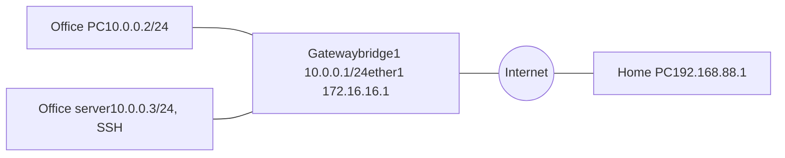

# NAT

> Network address translation in RouterOS: masquerade and source NAT for a local network, destination NAT for port forwarding, hairpin NAT, redirect, 1:1 NAT, CGNAT, endpoint-independent NAT and the NAT helpers.

# NAT

Network address translation (NAT) lets the hosts of a local network use one set of IP addresses inside the network and another set of addresses outside it. The NAT router rewrites the addresses of the packets on their way to and from the local network.

NAT rules are in the `/ip/firewall/nat` menu for IPv4 and in the `/ipv6/firewall/nat` menu for IPv6. RouterOS does not support NAT64.

A NAT rule matches only the first packet of a connection. [Connection tracking](../connection-tracking) remembers the translation and applies it to all other packets of the connection.

:::note
A NAT rule that you add, change or remove does not affect connections that are already open: they keep their translation until they end. To apply the new rules to them at once, remove the connections from the connection list, see [Connection tracking](../connection-tracking).
:::

The examples on this page use the network of the diagrams: the local network 10.0.0.0/24 behind the gateway 10.0.0.1, and the public address 172.16.16.1 on the interface to the internet. The interface lists `WAN` and `LAN` hold the interface to the internet and the local bridge, as in the default configuration. In your own rules, replace the local network 10.0.0.0/24, the server 10.0.0.3 and the public address 172.16.16.1 with your values.

When several NAT rules of a chain match a connection, the first one in the list is used. Some examples therefore place their rule before the masquerade rule, which they find by the comment that the masquerade example on this page gives it. On your router, use the comment of your own source NAT rule for the local network, whether it is a masquerade or a `src-nat` rule.

## Types of NAT and chains


There are two types of NAT:

- **Source NAT** (`chain=srcnat`) is applied to packets that leave the local network. The router replaces the private source address of a packet with a public address, and does the reverse for the reply packets.
- **Destination NAT** (`chain=dstnat`) is applied to packets that arrive for the local network. The router replaces the destination address of a packet with the address of a host in the local network. It is most often used to make a host of the local network reachable from the internet.

The NAT table also has the `input` and `output` chains, for packets that are delivered to the router itself and packets that the router itself sends:

- **input** - processes packets that enter the router and have one of the addresses of the router as their destination. Packets that pass through the router are not processed by the rules of this chain.
- **output** - processes packets that the router itself sends. Packets that pass through the router are not processed by the rules of this chain.

## Source NAT

### Masquerade

To give the hosts of the local network access to the internet through the public address of the router, use `action=masquerade`. The router replaces the source address with the address of the interface through which the packet leaves. The default configuration has such a rule.

```ros
/ip/firewall/nat
add chain=srcnat action=masquerade src-address=10.0.0.0/24 \
    out-interface-list=WAN comment="Masquerade the local network"
```

Masquerade is made for a public address that can change, for example an address from the DHCP server of the provider or from a PPPoE connection.

When the interface goes down or its address changes, the router removes all masqueraded connections of that interface from the connection list. This makes the recovery after an address change faster. On unstable links with a second way to the internet it can have a side effect:

- When the link goes down, the router removes the masqueraded connections.
- The next packet of each removed connection arrives in the firewall as a new connection. If the primary link is not back, the packet leaves through the other route, and a new masqueraded connection is created there.
- When the primary link comes back, routing uses it again, and the packets of these connections leave through the primary interface without being masqueraded. Local addresses leak to the public network.

To avoid this, add a blackhole route as an alternative to the route that can disappear.

### Source NAT to a fixed address

When the public address does not change, you can use `action=src-nat` in place of masquerade and set the address in `to-addresses`. Disable or remove the masquerade rule for the same traffic, or put this rule before it:

```ros
/ip/firewall/nat
add chain=srcnat action=src-nat src-address=10.0.0.0/24 \
    out-interface-list=WAN to-addresses=172.16.16.1 \
    comment="Source NAT to the public address"
```

The provider now sees all requests coming from 172.16.16.1 and does not see the addresses of the local network. With `src-nat`, the connections stay in the connection list when the interface goes down.

To check a source NAT rule, send traffic from the local network and look at the counters. The rule counts one packet for each new connection:

```ros
/ip/firewall/nat/print stats where comment~"Source NAT"
```

```text
Columns: CHAIN, ACTION, BYTES, PACKETS
# CHAIN   ACTION   BYTES  PACKETS
;;; Source NAT to the public address
0 srcnat  src-nat     56        1
```

Hosts behind NAT do not have true end-to-end connectivity. Protocols that need a connection that is opened from the outside, and some protocols without connections such as UDP, can fail. The NAT helpers and destination NAT, described on this page, work around these limits.

## Destination NAT

The office has a PC and a server behind the gateway. The administrator connects from a home PC on the internet. The examples use 172.16.16.1 and 192.168.88.1 in place of public addresses:



Destination NAT, often called port forwarding, makes a host of the local network reachable from the internet. In this example the administrator wants to reach the SSH service of the office server 10.0.0.3 from home. The rule translates connections to TCP port 22 of the public address 172.16.16.1 to the server:

```ros
/ip/firewall/nat
add chain=dstnat action=dst-nat protocol=tcp \
    dst-address=172.16.16.1 dst-port=22 to-addresses=10.0.0.3 \
    comment="SSH to the server"
```

The default firewall accepts forwarded connections that are destination NATed, so no filter rule is needed. In a firewall that you built yourself, accept these connections in the forward chain, see [Filter](./filter).

A forwarded port no longer reaches the router itself: with this rule, SSH to the public address opens the server and not the router.

To check the rule, connect from the internet and look at the counters:

```ros
/ip/firewall/nat/print stats where comment~"SSH"
```

```text
Columns: CHAIN, ACTION, BYTES, PACKETS
# CHAIN   ACTION   BYTES  PACKETS
;;; SSH to the server
0 dstnat  dst-nat     60        1
```

A port forward opens the service to everyone on the internet. Limit it to the addresses that need it when you can. To allow only the home PC, whose public address is 192.168.88.1 in the diagram, add its address to the rule:

```ros
/ip/firewall/nat
set [find comment="SSH to the server"] src-address=192.168.88.1
```

To forward a public port to another port of the server, set `to-ports`. This rule forwards port 8080 of the public address to the web server on port 80 of the server:

```ros
/ip/firewall/nat
add chain=dstnat action=dst-nat protocol=tcp \
    dst-address=172.16.16.1 dst-port=8080 \
    to-addresses=10.0.0.3 to-ports=80 \
    comment="Web server on port 8080"
```

When the public address of the router changes, match the interface in place of the address. This rule forwards port 8443 of any address of the router on the `WAN` interfaces to port 443 of the server. `dst-address-type=local` limits it to the addresses of the router itself:

```ros
/ip/firewall/nat
add chain=dstnat action=dst-nat protocol=tcp dst-port=8443 \
    in-interface-list=WAN dst-address-type=local \
    to-addresses=10.0.0.3 to-ports=443 \
    comment="Web server, any public address"
```

## Hairpin NAT

Hairpin NAT, also called NAT loopback, lets a host of the local network reach another host of the same network through the public address of the router.

The router has this destination NAT rule for the web server:

```ros
/ip/firewall/nat
add chain=dstnat action=dst-nat protocol=tcp \
    dst-address=172.16.16.1 dst-port=443 \
    to-addresses=10.0.0.3 to-ports=443 comment="Web server"
```

When the home PC connects to the web server, destination NAT works as expected:

1. The client sends a packet with the source address 192.168.88.1 to the destination address 172.16.16.1, port 443.
2. The router replaces the destination address with 10.0.0.3. The source address stays 192.168.88.1.
3. The server replies with the source address 10.0.0.3 to the destination address 192.168.88.1.
4. The router finds the connection of the reply and undoes the destination NAT: the source address of the reply becomes 172.16.16.1.
5. The client receives the reply that it expects, and the connection is established.


A client in the same network as the web server has a problem when it connects to the public address:

1. The client sends a packet with the source address 10.0.0.2 to the destination address 172.16.16.1, port 443.
2. The router replaces the destination address with 10.0.0.3. The source address stays 10.0.0.2.
3. The server replies. The source address of the request is in its own network, so the server does not send the reply to the router: it sends it directly to 10.0.0.2, with the source address 10.0.0.3.
4. The client receives the reply and discards it, because it expects a reply from 172.16.16.1 and not from 10.0.0.3.

To solve this, add a source NAT rule for connections from the local network to the server, the hairpin NAT rule:

```ros
/ip/firewall/nat
add chain=srcnat action=masquerade protocol=tcp \
    src-address=10.0.0.0/24 dst-address=10.0.0.3 \
    out-interface-list=LAN comment="Hairpin NAT"
```

With this rule:

1. The client sends a packet with the source address 10.0.0.2 to the destination address 172.16.16.1, port 443.
2. The router replaces the destination address with 10.0.0.3, and also replaces the source address with its own address in the local network, 10.0.0.1.
3. The server replies to 10.0.0.1.
4. The router undoes both translations: the reply reaches the client with the source address 172.16.16.1 and the destination address 10.0.0.2.

The server sees these connections coming from the address of the router, 10.0.0.1, and not from the address of the client.

To check, open the service from a host of the local network through the public address, and look at the counters of both rules:

```ros
/ip/firewall/nat/print stats where comment~"Hairpin|Web server"
```

```text
Columns: CHAIN, ACTION, BYTES, PACKETS
# CHAIN   ACTION      BYTES  PACKETS
;;; Web server on port 8080
0 dstnat  dst-nat        60        1
;;; Web server
1 dstnat  dst-nat       180        3
;;; Hairpin NAT
2 srcnat  masquerade     60        1
```

## Redirect DNS requests to the router

`action=redirect` sends a connection to the router itself instead of its destination. This example makes all hosts of the local network use the DNS server of the router, whatever DNS server they are configured with. The router must answer DNS requests:

```ros
/ip/dns
set allow-remote-requests=yes
```

With this setting the router answers DNS requests on all interfaces. The default firewall drops the requests that arrive from the internet; on a router without such rules, add them, so that the router is not an open resolver.

```ros
/ip/firewall/nat
add chain=dstnat action=redirect protocol=udp dst-port=53 \
    in-interface-list=LAN to-ports=53 comment="DNS to the router"
add chain=dstnat action=redirect protocol=tcp dst-port=53 \
    in-interface-list=LAN to-ports=53 comment="DNS to the router"
```

A host of the local network that asks any DNS server on port 53 now gets its answer from the router. Requests with DNS over HTTPS or DNS over TLS use other ports and are not redirected.

```ros
/ip/firewall/nat/print stats where comment~"DNS"
```

```text
Columns: CHAIN, ACTION, BYTES, PACKETS
# CHAIN   ACTION    BYTES  PACKETS
;;; DNS to the router
3 dstnat  redirect     56        1
;;; DNS to the router
4 dstnat  redirect      0        0
```

## Map a public subnet to local addresses

`action=netmap` translates a whole subnet to another subnet of the same size, address by address (1:1 NAT). In this example the provider routes the public subnet 172.16.16.8/29 to the router. Each address of it is mapped to the local address with the same last bits: 172.16.16.11 to 10.0.0.11, and so on.

```ros
/ip/firewall/nat
add chain=dstnat action=netmap dst-address=172.16.16.8/29 \
    in-interface-list=WAN to-addresses=10.0.0.8/29 \
    comment="1:1 NAT, to the local addresses"
add chain=srcnat action=netmap src-address=10.0.0.8/29 \
    out-interface-list=WAN to-addresses=172.16.16.8/29 \
    comment="1:1 NAT, to the public addresses" \
    place-before=[find comment="Masquerade the local network"]
```

The first rule translates connections from the internet to the public addresses. The second rule translates the connections that the local hosts open, so that they leave with their own public address. It has to be before the masquerade rule, which would otherwise match first.

:::warning
The first rule makes every port of the mapped hosts reachable from the internet, because the default firewall accepts destination NATed connections. Add filter rules in the forward chain that accept only the services that you want to offer, see [Filter](./filter).
:::

```ros
/ip/firewall/nat/print stats where comment~"1:1"
```

```text
Columns: CHAIN, ACTION, BYTES, PACKETS
# CHAIN   ACTION  BYTES  PACKETS
;;; 1:1 NAT, to the public addresses
0 srcnat  netmap     56        1
;;; 1:1 NAT, to the local addresses
1 dstnat  netmap     56        1
```

## CGNAT (NAT444)


Carrier-grade NAT saves public IPv4 addresses. The provider uses the shared address space 100.64.0.0/10 (RFC 6598) inside its network and translates it to one public address, or to a range of them, on its edge router. The setup is also called NAT444, because three IPv4 address spaces are involved, as opposed to NAT44 for NAT in one place.

The CGNAT configuration is a source NAT rule like any other. In this example 203.0.113.2 is the public address:

```ros
/ip/firewall/nat
add chain=srcnat action=src-nat src-address=100.64.0.0/10 \
    out-interface-list=WAN to-addresses=203.0.113.2
```

NAT444 uses fewer public IPv4 addresses, but it has major drawbacks:

- The router that does CGNAT keeps the state of all translations, which needs a lot of memory and CPU resources.
- Some console games fail when two subscribers behind the same public address try to connect to each other.
- Tracking users for legal reasons needs extra logging, because many households share one public address.
- Everything that needs incoming connections is broken. With NAT in one place, users can set up port forwarding on their router; with CGNAT they cannot. They cannot host a web server, and IP phones cannot receive incoming calls by default.
- Some web servers limit the number of connections from one public address, to counter DoS attacks such as SYN floods. With CGNAT this limit is reached more often, and the service quality can suffer.
- 6to4 needs globally reachable addresses and does not work in networks with addresses of limited reach.

Packets with a source or destination address of the shared address space must not be forwarded across the borders of the provider's network, and providers must filter them on the links to other networks. On the edge router, drop them in the firewall filter. Do not drop packets with a shared source address on their way out to the internet on the router that does the CGNAT: the filter processes a packet before source NAT, so such a rule would drop the traffic of the subscribers.

```ros
/ip/firewall/filter
add chain=input action=drop src-address=100.64.0.0/10 \
    in-interface-list=WAN
add chain=output action=drop dst-address=100.64.0.0/10 \
    out-interface-list=WAN
add chain=forward action=drop src-address=100.64.0.0/10 \
    in-interface-list=WAN
add chain=forward action=drop dst-address=100.64.0.0/10 \
    out-interface-list=WAN
```

Providers can be required to log the mapped addresses, which is a problem in a large network. RFC 7422 describes a way to reduce the logging: instead of logging each connection, the CGN router maps each private address to a public address with a fixed range of ports. This needs a rule for each mapping:

| Inside IP | Outside IP and port range |
| :-- | :-- |
| 100.64.0.1 | 203.0.113.2:5000-5199 |
| 100.64.0.2 | 203.0.113.2:5200-5399 |
| 100.64.0.3 | 203.0.113.2:5400-5599 |
| 100.64.0.4 | 203.0.113.2:5600-5799 |

These rules replace the single source NAT rule of the first example: use one or the other. Create the rules with a script instead of writing them by hand. Change the six values at the top to fit your network. Save the script to a file and run it with `/import`, or store it in `/system/script` to create the rules again later.

```ros
{
######## Adjustable values #########
:local StartingAddress 100.64.0.1
:local ClientCount 2
:local AddressesPerClient 2
:local PublicAddress 203.0.113.2
:local StartingPort 5000
:local PortsPerAddress 200
####################################

# All client chain jump
:local count ($ClientCount * $AddressesPerClient)
:local last ($StartingAddress + $count - 1)
/ip/firewall/nat/add chain=srcnat action=jump jump-target=clients \
    src-address="$StartingAddress-$last"

:local currentPort $StartingPort

:for c from=1 to=$ClientCount do={
    # Specific client chain jumps
    :local first ($StartingAddress + ($AddressesPerClient * ($c - 1)))
    :local range $first
    :if ($AddressesPerClient > 1) do={
        :set range "$first-$($first + $AddressesPerClient - 1)"
    }
    /ip/firewall/nat/add chain=clients action=jump \
        jump-target="client-$c" src-address=$range

    # Translation rules
    :for a from=1 to=$AddressesPerClient do={
        :local addr ($first + $a - 1)
        :local lastPort ($currentPort + $PortsPerAddress - 1)
        :local ports "$currentPort-$lastPort"
        /ip/firewall/nat/add chain="client-$c" action=src-nat \
            protocol=tcp src-address=$addr \
            to-addresses=$PublicAddress to-ports=$ports
        /ip/firewall/nat/add chain="client-$c" action=src-nat \
            protocol=udp src-address=$addr \
            to-addresses=$PublicAddress to-ports=$ports
        :set currentPort ($currentPort + $PortsPerAddress)
    }
}
}
```

The script creates these rules:

```ros
/ip/firewall/nat/print
```

```text
 0  chain=srcnat action=jump jump-target=clients
    src-address=100.64.0.1-100.64.0.4
 
 1  chain=clients action=jump jump-target=client-1
    src-address=100.64.0.1-100.64.0.2
 
 2  chain=client-1 action=src-nat to-addresses=203.0.113.2 to-ports=5000-5199
    protocol=tcp src-address=100.64.0.1
 
 3  chain=client-1 action=src-nat to-addresses=203.0.113.2 to-ports=5000-5199
    protocol=udp src-address=100.64.0.1
 
 4  chain=client-1 action=src-nat to-addresses=203.0.113.2 to-ports=5200-5399
    protocol=tcp src-address=100.64.0.2
 
 5  chain=client-1 action=src-nat to-addresses=203.0.113.2 to-ports=5200-5399
    protocol=udp src-address=100.64.0.2
 
 6  chain=clients action=jump jump-target=client-2
    src-address=100.64.0.3-100.64.0.4
 
 7  chain=client-2 action=src-nat to-addresses=203.0.113.2 to-ports=5400-5599
    protocol=tcp src-address=100.64.0.3
 
 8  chain=client-2 action=src-nat to-addresses=203.0.113.2 to-ports=5400-5599
    protocol=udp src-address=100.64.0.3
 
 9  chain=client-2 action=src-nat to-addresses=203.0.113.2 to-ports=5600-5799
    protocol=tcp src-address=100.64.0.4
 
10  chain=client-2 action=src-nat to-addresses=203.0.113.2 to-ports=5600-5799
    protocol=udp src-address=100.64.0.4
```

## Endpoint-independent NAT

Endpoint-independent NAT creates a mapping for a source address and port of the local network, and uses the same mapping for all later packets from that address and port, whatever their destination. The first rule creates the mappings. It has to be before the masquerade rule:

```ros
/ip/firewall/nat
add chain=srcnat action=endpoint-independent-nat protocol=udp \
    out-interface-list=WAN comment="Endpoint-independent mapping" \
    place-before=[find comment="Masquerade the local network"]
add chain=dstnat action=endpoint-independent-nat protocol=udp \
    in-interface-list=WAN comment="Endpoint-independent filtering"
```

The second rule enables endpoint-independent filtering: a packet from any source on the internet that arrives for a mapped address and port is forwarded to the local host of the mapping. This opens each mapped UDP port of the local hosts to the whole internet for as long as the mapping exists.

Endpoint-independent NAT works only with UDP: the rules need `protocol=udp`. The `randomise-ports` option makes the router choose the public port of a mapping at random.

See RFC 5128, sections 2.2.3 and 2.2.5, for the background.

## NAT helpers

Some protocols carry addresses or ports inside their data, or open additional connections, and do not work through NAT without help. RouterOS has NAT helpers for such protocols in the `/ip/firewall/service-port` menu:

```ros
/ip/firewall/service-port/print
```

```text
Flags: X - DISABLED, I - INVALID
Columns: NAME, PORTS
#   NAME     PORTS
0   ftp         21
1   tftp        69
2 X irc       6667
3   h323          
4   sip       5060
              5061
5   pptp          
6 X rtsp       554
7   udplite       
8   dccp          
9   sctp          
```

- `ftp`, `tftp`, `irc`, `h323`, `sip`, `pptp` and `rtsp` are helpers for these protocols. You can disable each of them, and some have a `ports` setting.
- The `sip` helper has two more settings. `sip-direct-media` allows the RTP media stream to go directly from the caller to the callee; the default is `yes`. `sip-timeout` is the timeout of SIP UDP connections, one hour by default; some setups need a lower value.
- `udplite`, `dccp` and `sctp` are built into connection tracking. They cannot be disabled separately: they are off only when connection tracking is off.

When connection tracking is not active, all service ports are shown as invalid, with the `I` flag.

The settings are described in the CLI reference of [`/ip/firewall/service-port`](../../cli-reference/ip/firewall/service-port). All NAT properties are in the CLI reference of [`/ip/firewall/nat`](../../cli-reference/ip/firewall/nat) and [`/ipv6/firewall/nat`](../../cli-reference/ipv6/firewall/nat).
