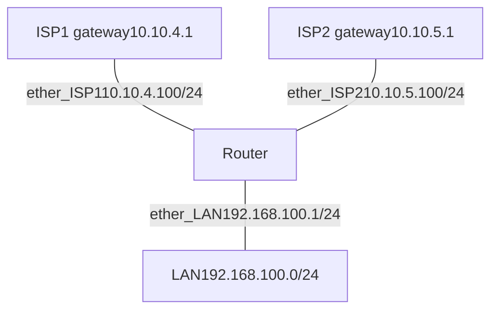

# Per connection classifier

> Per connection classifier (PCC) in RouterOS: balance connections over two internet links with mangle rules, routing tables and failover, a complete example, and how the classifier divides connections.

# Per connection classifier

The per connection classifier (PCC) is a firewall matcher that divides connections into groups and keeps all packets of a connection in the same group. Its most common use is to share the connections of a network between two or more internet links.

PCC takes selected fields of the packet header (addresses, ports), makes a 32-bit hash of them, divides the hash by a number (the denominator) and compares the remainder with a given value. The syntax is:

```ros
per-connection-classifier=
PerConnectionClassifier ::= [!]ValuesToHash:Denominator/Remainder
  Remainder ::= 0..4294967295    (integer number)
  Denominator ::= 1..4294967295    (integer number)
  ValuesToHash ::= both-addresses|both-ports|dst-address-and-port|
  src-address|src-port|both-addresses-and-ports|dst-address|dst-port|src-address-and-port 
```

For example, `both-addresses:2/0` and `both-addresses:2/1` are the two halves of all pairs of source and destination address.

PCC only matches packets. It does not send traffic anywhere: the connection marks have an effect only when other rules change them into routing marks, and routing tables with those names have routes. The example on this page has all the parts.

:::warning
PCC does not work together with HotSpot: HotSpot uses a web proxy, which uses only the main routing table.
:::

## Balance two internet links

In this example the router has two provider interfaces, `ether_ISP1` with the address 10.10.4.100/24 and the gateway 10.10.4.1, and `ether_ISP2` with 10.10.5.100/24 and the gateway 10.10.5.1. The LAN interface `ether_LAN` has 192.168.100.1/24. On a router with the default configuration, use your interface names: the LAN interface is `bridge`, and the second provider port must first be removed from the bridge (`/interface/bridge/port/remove [find interface=ether2]`).



```ros
/ip/address
add address=10.10.4.100/24 interface=ether_ISP1
add address=10.10.5.100/24 interface=ether_ISP2
add address=192.168.100.1/24 interface=ether_LAN
```

### Routing tables

Add a routing table for each provider:

```ros
/routing/table
add name=ISP1_table fib
add name=ISP2_table fib
```

### Keep connected networks in the main table

The classification rules that follow look at all connections from the LAN. Traffic to the networks that are connected to the router must not get a routing mark, or the router sends it to a provider gateway and the hosts of those networks cannot be reached. Put the connected networks into an address list and accept them before the other mangle rules. `accept` ends the mangle processing of a packet:

```ros
/ip/firewall/address-list
add address=10.10.4.0/24 list=ConnectedNetworks
add address=10.10.5.0/24 list=ConnectedNetworks
add address=192.168.100.0/24 list=ConnectedNetworks
/ip/firewall/mangle
add chain=prerouting action=accept \
    dst-address-list=ConnectedNetworks
add chain=output action=accept dst-address-list=ConnectedNetworks
```

The rule in the `output` chain does the same for the connections of the router itself. Without it, the router cannot reach the devices of its own LAN after the rules for its own connections are added.

### Classify the connections of the LAN

The mangle rules below identify the new connections of the LAN and divide them between the two providers:

```ros
/ip/firewall/mangle
add chain=prerouting action=mark-connection \
    connection-mark=no-mark connection-state=new \
    dst-address-type=!local in-interface=ether_LAN \
    per-connection-classifier=both-addresses:2/0 \
    new-connection-mark=ISP1
add chain=prerouting action=mark-connection \
    connection-mark=no-mark connection-state=new \
    dst-address-type=!local in-interface=ether_LAN \
    per-connection-classifier=both-addresses:2/1 \
    new-connection-mark=ISP2
```

- `connection-mark=no-mark` selects only the connections that do not belong to a group yet, and `connection-state=new` keeps the match to the start of the connection. The classification therefore runs once, on its first packets, and never again for the packets that follow; the mark belongs to all packets of the connection.
- `per-connection-classifier` puts the connection into one of two groups by its source and destination address.
- `dst-address-type=!local` leaves out packets for the router itself.
- The rules are in the `prerouting` chain, because the routing mark must be set before the routing decision. A connection that is marked first in the `forward` chain leaves with its first packet through the main table: connections of one packet, such as DNS requests, would always use the main table, and the other packets of a TCP connection would leave through another provider than the first one.

### Change the connection marks into routing marks

```ros
/ip/firewall/mangle
add chain=prerouting action=mark-routing connection-mark=ISP1 \
    in-interface=ether_LAN new-routing-mark=ISP1_table
add chain=prerouting action=mark-routing connection-mark=ISP2 \
    in-interface=ether_LAN new-routing-mark=ISP2_table
```

`mark-routing` works only in the `prerouting` and `output` chains. The `prerouting` rules have `in-interface=ether_LAN`, so that packets that arrive from the providers follow the normal routing decision: traffic that only the main routing table can reach would otherwise leave the route lookup inside a provider table. The connections of the router convert their marks in the `output` chain (the section below); without them, the two rules above are all the example needs.

### Routes

Add a default route to each provider table, and two default routes with different distances to the main table:

```ros
/ip/route
add gateway=10.10.4.1 routing-table=ISP1_table check-gateway=ping
add gateway=10.10.5.1 routing-table=ISP2_table check-gateway=ping
add gateway=10.10.4.1 distance=1 check-gateway=ping
add gateway=10.10.5.1 distance=2 check-gateway=ping
```

The routes of the main table give failover. When a provider gateway does not answer, `check-gateway` makes the route of its table inactive. The traffic with that routing mark then uses the [main routing table](../../user-guides/routing-and-networking-protocols/routing-decision), where the route through the other provider is active.

The routes of the main table need `check-gateway=ping` too. Without it, the route through a failed gateway stays active there, and connections of that group are lost. Connections that are open when a gateway fails or comes back can break and must be opened again.

### NAT

With the default configuration, add both provider interfaces to the `WAN` interface list: its masquerade rule and its firewall then cover both, and the two rules below are not needed.

The default fasttrack rule needs one change. Packets of a fasttracked connection travel through the fast path, which looks up the route before the routing marks take effect: the marked connections would leave through the main routing table, and their packets would follow whatever the main table decides instead of the provider of their group. Add `connection-mark=no-mark`, so the rule keeps fasttracking the unmarked connections and stops covering the marked ones:

```ros
/ip/firewall/filter
set [find comment="defconf: fasttrack"] connection-mark=no-mark
```

The marked connections then skip fasttrack and keep their `prerouting` `mark-routing` rules; the unmarked connections keep fasttrack and their place in the main table.

Without the default configuration, add a masquerade rule for each interface. The routing decision is made by now. The NAT rules only set the source address of the packets: 10.10.4.100 for those that leave through `ether_ISP1` and 10.10.5.100 for `ether_ISP2`.

```ros
/ip/firewall/nat
add chain=srcnat action=masquerade out-interface=ether_ISP1
add chain=srcnat action=masquerade out-interface=ether_ISP2
```

### Check

- `/ip/firewall/mangle/print stats` shows the packet counters of the rules. With traffic from several devices to several destinations, both `mark-connection` rules of the LAN count packets.
- `/ip/route/print` shows the routes of the three tables. A route of a failed gateway has the flag `I`.
- `/ip/firewall/connection/print` shows the mark of each connection in `connection-mark`.

With `both-addresses`, all connections between one device and one server use the same provider. Different servers can use different providers, so a test to a single server always shows the same link.

## Connections of the router

The example above moves the connections between the LAN and the internet. The router also has connections of its own: the answers to the connections that come to the router from the internet, for example to a VPN server, and the connections that the router starts. This section is optional: a router that only serves the LAN users and runs no services at all can leave these rules out.

```ros
/ip/firewall/mangle
add chain=input action=mark-connection connection-state=new \
    in-interface=ether_ISP1 new-connection-mark=ISP1
add chain=input action=mark-connection connection-state=new \
    in-interface=ether_ISP2 new-connection-mark=ISP2
add chain=output action=mark-connection \
    connection-mark=no-mark connection-state=new \
    per-connection-classifier=both-addresses:2/0 \
    new-connection-mark=ISP1
add chain=output action=mark-connection \
    connection-mark=no-mark connection-state=new \
    per-connection-classifier=both-addresses:2/1 \
    new-connection-mark=ISP2
add chain=output action=mark-routing connection-mark=ISP1 \
    new-routing-mark=ISP1_table
add chain=output action=mark-routing connection-mark=ISP2 \
    new-routing-mark=ISP2_table
```

- The `input` rules do not use the classifier: the mark remembers the interface that the connection came in on, so its answers leave through the same interface from the same public address.
- The `output` rules split the connections that the router starts into the two groups by the classifier, and `mark-routing` converts their marks in the `output` chain, because packets of the router do not pass `prerouting`.

Port-forwarded connections come in from the outside, on one provider interface. A `chain=forward` rule with `in-interface=ether_ISP1` marks the whole connection from its first packet on. That mark is set one chain later than a `prerouting` rule would set it, which does not change the outcome here: the routing decision for the inbound packet happens before the forward chain anyway, and from the first reply on, the `prerouting` `mark-routing` rules see the mark of the connection. The same fasttrack change from the NAT section applies to these connections: without it, their fasttracked packets would skip `prerouting` and leave through the main table.

## Failover with more than two links

Extend the example above with a third provider on `ether_ISP3` (gateway 10.10.6.1), the routing table `ISP3_table`, and a third masquerade rule (or move all provider interfaces into the `WAN` list).

With one default route in each provider table, the share of a failed link falls back to the main table and leaves through one provider by distance. To divide the failed share over all remaining links instead, each table keeps the remaining gateways as one equal-distance set:

```ros
/ip/route
add gateway=10.10.4.1 routing-table=ISP1_table check-gateway=ping
add gateway=10.10.5.1 routing-table=ISP1_table distance=2 check-gateway=ping
add gateway=10.10.6.1 routing-table=ISP1_table distance=2 check-gateway=ping

add gateway=10.10.5.1 routing-table=ISP2_table check-gateway=ping
add gateway=10.10.4.1 routing-table=ISP2_table distance=2 check-gateway=ping
add gateway=10.10.6.1 routing-table=ISP2_table distance=2 check-gateway=ping

add gateway=10.10.6.1 routing-table=ISP3_table check-gateway=ping
add gateway=10.10.4.1 routing-table=ISP3_table distance=2 check-gateway=ping
add gateway=10.10.5.1 routing-table=ISP3_table distance=2 check-gateway=ping
```

Each table carries its traffic through its own provider first. When the gateway of a table stops answering, the two `distance=2` routes join into one ECMP route (flag `+` in `/ip/route/print`), and the share of the failed link leaves equally through the two remaining links. In the three-link setup, every link carries a third of the connections, and each remaining link ends up with half of the full flow.

The split between the remaining links follows the ECMP hash policy. By default, the Layer3 policy hashes each connection by its addresses and keeps it on one link. With [L3 hardware offloading](../../bridging-and-switching/l3-hardware-offloading.md), the switch uses its own hash mask, and the configured hash policy is ignored; [Multipath (ECMP) routes](../../user-guides/routing-and-networking-protocols/routing-decision#multipath-ecmp-routes) describes the details. Connections that are open when a link fails or comes back follow the two-link rule: they break and must be opened again.

If the failed share should move in a known order instead of spreading equally, give each fallback route in a table a different `distance`. Every table then sends its traffic to the lowest active distance, and each table keeps its own preference order.

## How PCC works

This article aims to explain in simple terms how PCC works. The definition from the official manual wiki page reads: "PCC takes selected fields from the IP header, and with the help of a hashing algorithm converts selected fields into a 32-bit value. This value then is divided by a specified Denominator and the remainder then is compared to a specified Remainder, if equal then the packet will be captured. You can choose from src-address, dst-address, src-port, dst-port from the header to use in this operation.", with the full number of fields available being: "both-addresses|both-ports|dst-address-and-port|src-address|src-port|both-addresses-and-ports|dst-address|dst-port|src-address-and-port". If you understand that definition, there'll be nothing interesting in this article for you.

First, here are the terms necessary to understand the definition.

IP packets have a header that contains several fields. Two of those fields are the IP address of the source of the packet and the IP address of the destination of the packet. TCP and UDP packets also have headers that contain the source port and the destination port.

Denominators and remainders are parts of modulus operations. A modulus operation produces the integer left over when you divide two numbers and only accepts the whole number portion of the result. It is represented by a % sign. Here are some examples: 3 % 3 = 0, because 3 divides cleanly by 3. 4 % 3 = 1, because the next smallest number before 4 that cleanly divides by 3 is 3, and 4 - 3 = 1. 5 % 3 is 2, because the next smallest number before 5 that divides cleanly by 3 is 3, and 5 - 3 = 2. 6 % 3 = 0, because 6 divides cleanly by 3.

A hash is a function that is fed input, and produces output. Hashes have many interesting properties, but the only important one for the purpose of this article is that hash functions are deterministic. That means that when you feed a hash function an input that reads 'hello' and it produces the output '1', you can rely on the fact that if you feed it 'hello' a second time it will produce the output '1' again. When you feed a hash function the same input, it will always produce the same output. What exact hashing algorithm is used by PCC is not important, so for this discussion let's assume that when you feed it IP addresses and ports, it just adds up the octets of the IP addresses as decimal numbers as well as the ports, and then takes the last digit and produces it as the output. Here is an example:

The hash function is fed 1.1.1.1 as the source IP address, 10000 as the source TCP port, 2.2.2.2 as the destination IP address and 80 as the destination TCP port. The output will be 1+1+1+1+10000+2+2+2+2+80 = 10092. The last digit of that is 2, so the hash output is 2. It will produce 2 every time it is fed that combination of IP addresses and ports.

At this point it's important to note that even though PCC is most often used for spreading load across circuits, PCC itself has absolutely nothing to do with routing, routing marks or spreading load. PCC is simply a way to match packets, and not directly related to the action of then marking those matched packets even if that is its main purpose.

Mangle rules that classify connections by PCC look like this:

```ros
/ip/firewall/mangle/add chain=prerouting action=mark-connection \
 new-connection-mark=1st_conn per-connection-classifier=src-address-and-port:3/0
/ip/firewall/mangle/add chain=prerouting action=mark-connection \
  new-connection-mark=2nd_conn per-connection-classifier=src-address-and-port:3/1
/ip/firewall/mangle/add chain=prerouting action=mark-connection \
  new-connection-mark=3rd_conn per-connection-classifier=src-address-and-port:3/2
```

The three rules classify connections only. In a working load-balancing setup the surrounding pieces matter just as much: which packets are accepted before classification, where connection marks become routing marks, and which routes the special routing tables hold. The Configuration Example puts all of those pieces together.

Here is what the different field options mean for the purpose of packet matching, these are the fields that will be fed into the hashing algorithm (and, for the purpose of spreading load across links, decide what link a packet will be put on). Remember that a hash function will always produce the same output when it's fed the same input:

- src-address: The source address of a client will always be the same, so all traffic from a particular client will always match the same PCC matcher, and will always be put on the same link.
- dst-address: The destination address of a specific server will always be the same, so all traffic to that server (say, the Mikrotik Wiki) will always match the same PCC matcher, and will always be put on the same link.
- both-addresses: The source and destination IP pair between the same client and server will always be the same, so all traffic between one specific client and a specific server (say, your laptop and the Mikrotik Wiki) will always match the same PCC matcher, and will always be put on the same link.
- src-port: Source ports of clients are usually randomly chosen when the connection is created, so across many connections different source ports will be fed into the hash function, and different PCC matchers will match and traffic will go across different links. However, some client protocols always choose the same source port, and servers behind your router will most likely always use the same service port to send traffic back to their clients. A web server behind your router would send most traffic from its HTTP (80) and HTTPS (443) ports, and that traffic would always match the same PCC matcher and would be put on the same link.
- dst-port: Destination ports of clients are usually well defined service ports, all HTTP (80) traffic between your clients and servers on the Internet would always match the same PCC matcher, and would be put on the same link. However, the same clients doing HTTPS (443) traffic could match a different PCC matcher, and would go across a different link.
- both-ports: Since the client port is (usually) randomly chosen, the combination of the two ports is (usually) random and will spread load across links.
- src-address-and-port: Same caveat as src-port.
- dst-address-and-port: Same caveat as dst-port.
- both-addresses-and-ports: This is the most random way to spread traffic across links, since it has the most number of variables.

It's important to note that even though the hash function discussed in this article is greatly simplified and not what is used in real life, it nicely demonstrates another property of hash functions: two completely different inputs can produce the same output. In our example, 3 % 3 = 0, and 6 % 3 = 0; we get back 0 when we feed it a 3 as well as when we feed it a 6. The same is true for the actual function used for PCC, even though I don't know what it is, we do know from the definition that it produces a 32-bit value as output. IP addresses are 32 bits, and ports are 16 bits, so assuming that we're using both-addresses-and-ports, we'd be feeding it 32+32+16+16 = 96 bits of input and would only receive 32 bits back, so it must be producing the same output for different inputs. This means that two completely unrelated connections could match the same PCC matcher, and would be put on the same line. PCC works better the more connections you put across it so that the hash function has more chances to produce different outputs.
