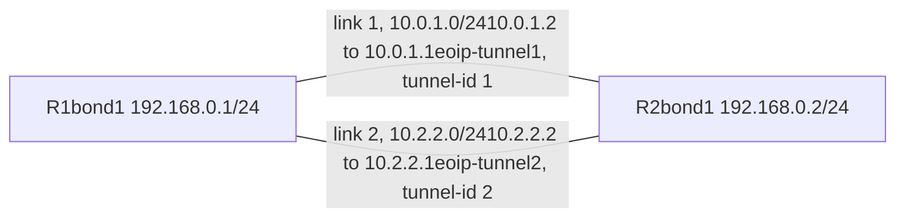

# Bonding Examples

> Bonding example for RouterOS: join two EoIP tunnels over two separate links between two routers into one bonded link, test it, and add ARP link monitoring so that a failed link is not used.

# Bonding Examples

## Bond two EoIP tunnels over two links

Two routers are connected with two separate IP links, for example two wireless links. This example joins the two links into one, to use the capacity of both and to keep the connection when one fails.

Bonding works on layer 2 (Ethernet) interfaces only, so each link first gets an [EoIP](../../virtual-private-networks/eoip) tunnel. The bond then uses the two tunnels.

In the example the first link has the network 10.0.1.0/24 and the second 10.2.2.0/24. R1 has the addresses 10.0.1.2 and 10.2.2.2, and R2 has 10.0.1.1 and 10.2.2.1:



On each router, `bond1` uses `eoip-tunnel1` and `eoip-tunnel2` as its slaves.

### Configuration

Add an EoIP tunnel over each link. On R1:

```ros
/interface/eoip/add name=eoip-tunnel1 remote-address=10.0.1.1 \
    tunnel-id=1
/interface/eoip/add name=eoip-tunnel2 remote-address=10.2.2.1 \
    tunnel-id=2
```

On R2:

```ros
/interface/eoip/add name=eoip-tunnel1 remote-address=10.0.1.2 \
    tunnel-id=1
/interface/eoip/add name=eoip-tunnel2 remote-address=10.2.2.2 \
    tunnel-id=2
```

Add a bonding interface with the tunnels as slaves, and an address on it. On R1:

```ros
/interface/bonding/add name=bond1 mode=balance-rr \
    slaves=eoip-tunnel1,eoip-tunnel2
/ip/address/add address=192.168.0.1/24 interface=bond1
```

On R2:

```ros
/interface/bonding/add name=bond1 mode=balance-rr \
    slaves=eoip-tunnel1,eoip-tunnel2
/ip/address/add address=192.168.0.2/24 interface=bond1
```

### Add link monitoring

The default link monitoring (MII) does not help here: the bond does not notice with it that the link of a tunnel failed, so it keeps sending packets into the failed tunnel and most of the traffic is lost. Use ARP monitoring, which checks that each tunnel really passes packets. On R1:

```ros
/interface/bonding/set [find name=bond1] link-monitoring=arp \
    arp-ip-targets=192.168.0.2
```

On R2:

```ros
/interface/bonding/set [find name=bond1] link-monitoring=arp \
    arp-ip-targets=192.168.0.1
```

When a link fails, the bond now moves its tunnel to `inactive-ports` and uses the other one:

```ros
[admin@R1] > /interface/bonding/monitor bond1 once
            mode: balance-rr  
    active-ports: eoip-tunnel1
  inactive-ports: eoip-tunnel2
```

### Test

The two routers reach each other with the addresses of 192.168.0.0/24. To see that the traffic uses both tunnels, watch the tunnels on R1 with `/interface/monitor-traffic eoip-tunnel1,eoip-tunnel2`, and send traffic from R2 with `/tool/bandwidth-test 192.168.0.1 direction=transmit`. The traffic is spread over both tunnels.

`balance-rr` sends the packets of one connection through both links, so they can arrive out of order when the links have different delays.

## Read more

- [Bonding](../bonding)
- [EoIP](../../virtual-private-networks/eoip)
