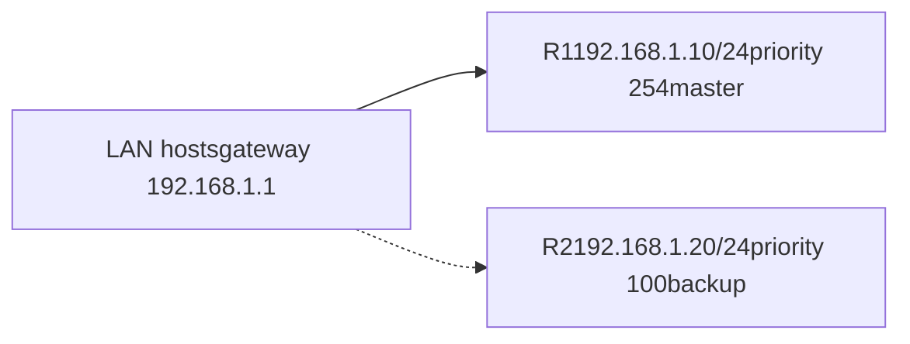

# VRRP Configuration Examples

> Basic VRRP configuration examples for RouterOS: a master and backup pair with a shared gateway, load sharing with two virtual routers, and a pair without preemption.

# VRRP Configuration Examples

These examples configure a redundant gateway with two RouterOS routers, R1 and R2. The examples use
`ether5` as the LAN-facing interface; replace it with the interface or bridge that connects to the
LAN. The routers share the VRID, the virtual address and the advertisement interval, and both run the
same RouterOS version.

See [VRRP](../vrrp) for the protocol, the virtual MAC address, master election and preemption.

## Basic setup

As long as R1 is available, it is the master and forwards all traffic for the virtual address. R2 is
the backup and stays idle. If R1 fails, R2 becomes master and continues to answer for the same
address, so the hosts' gateway setting does not change.



### R1 configuration

```ros
/ip/address/add address=192.168.1.10/24 interface=ether5
/interface/vrrp/add name=vrrp1 interface=ether5 vrid=49 priority=254
/ip/address/add address=192.168.1.1/32 interface=vrrp1
```

### R2 configuration

```ros
/ip/address/add address=192.168.1.20/24 interface=ether5
/interface/vrrp/add name=vrrp1 interface=ether5 vrid=49
/ip/address/add address=192.168.1.1/32 interface=vrrp1
```

Both routers have the same VRID and the same virtual address. R1 has the higher priority and is the
master. Name the VRRP interface explicitly on both routers so that the name does not depend on
automatically assigned numbers.

### Check the result

On R1:

```ros
/interface/vrrp/print detail
Flags: R - RUNNING; M - MASTER
0 RM name="vrrp1" mtu=1500 mac-address=00:00:5E:00:01:31 arp=enabled
     arp-timeout=auto interface=ether5 group-authority="" vrid=49 priority=254
     interval=1s preemption-mode=yes authentication=none on-backup=""
     on-master="" on-fail="" version=3 v3-protocol=ipv4 v3-checksum-as-v2=no
     sync-connection-tracking=no connection-tracking-mode=passive-active
```

On R2:

```ros
/interface/vrrp/print detail
Flags: B - BACKUP
0 B name="vrrp1" mtu=1500 mac-address=00:00:5E:00:01:31 arp=enabled
    arp-timeout=auto interface=ether5 group-authority="" vrid=49 priority=100
    interval=1s preemption-mode=yes authentication=none on-backup=""
    on-master="" on-fail="" version=3 v3-protocol=ipv4 v3-checksum-as-v2=no
    sync-connection-tracking=no connection-tracking-mode=passive-active
```

The virtual MAC address is the same on both routers. The master sends advertisements and answers ARP
requests for 192.168.1.1 with this address; the backup only listens.

To test a failover, disable the VRRP interface on R1 (`/interface/vrrp/disable [find name=vrrp1]`) or
disconnect the interface it runs on. A disabled master sends an advertisement with priority 0, so R2
takes over at once; after a disconnect, R2 becomes master when the master-down timer expires:

On R2:

```ros
/interface/vrrp/print
Flags: R - RUNNING; M - MASTER
Columns: NAME, INTERFACE, MAC-ADDRESS, VRID, PRIORITY, INTERVAL, VERSION, 
         V3-PROTOCOL, SYNC-CONNECTION-TRACKING
#    NAME   INTERFACE  MAC-ADDRESS        VRID  PRIORITY  IN  V  V3-P  SY
0 RM vrrp1  ether5     00:00:5E:00:01:31    49       100  1s  3  ipv4  no
```

Enable R1 again (`/interface/vrrp/enable [find name=vrrp1]`) or reconnect its interface. Preemption
is enabled by default, so R1 returns to the master role and R2 becomes backup. The virtual MAC
address does not change, so hosts keep the same gateway address in their ARP entry, and the new
master announces it.

## Load sharing

In the basic setup R2 is idle while it is the backup. With two virtual routers, each router can be
the master for one address and the backup for the other, so both routers forward traffic and each
backs up the other. This example replaces the basic setup; remove its VRRP interfaces and addresses
on both routers first.


In V1, R1 is the master and R2 is the backup. In V2, the roles are reversed. If one router fails, the
other takes over both virtual addresses. Each host uses one of the two addresses as its default
gateway: some hosts use 192.168.1.253, the others use 192.168.1.254.

### R1 configuration

```ros
/ip/address/add address=192.168.1.1/24 interface=ether5
/interface/vrrp/add name=vrrp1 interface=ether5 vrid=49 priority=254
/interface/vrrp/add name=vrrp2 interface=ether5 vrid=77
/ip/address/add address=192.168.1.253/32 interface=vrrp1
/ip/address/add address=192.168.1.254/32 interface=vrrp2
```

### R2 configuration

```ros
/ip/address/add address=192.168.1.2/24 interface=ether5
/interface/vrrp/add name=vrrp1 interface=ether5 vrid=49
/interface/vrrp/add name=vrrp2 interface=ether5 vrid=77 priority=254
/ip/address/add address=192.168.1.253/32 interface=vrrp1
/ip/address/add address=192.168.1.254/32 interface=vrrp2
```

Both virtual addresses are configured on both routers. The priorities give R1 the master role for
VRID 49 and R2 the master role for VRID 77.

### Check the result

On R1:

```ros
/interface/vrrp/print
Flags: R - RUNNING; M - MASTER, B - BACKUP
Columns: NAME, INTERFACE, MAC-ADDRESS, VRID, PRIORITY, INTERVAL, VERSION, 
         V3-PROTOCOL, SYNC-CONNECTION-TRACKING
#    NAME   INTERFACE  MAC-ADDRESS        VRID  PRIORITY  IN  V  V3-P  SY
0 RM vrrp1  ether5     00:00:5E:00:01:31    49       254  1s  3  ipv4  no
1  B vrrp2  ether5     00:00:5E:00:01:4D    77       100  1s  3  ipv4  no
```

On R2:

```ros
/interface/vrrp/print
Flags: R - RUNNING; M - MASTER, B - BACKUP
Columns: NAME, INTERFACE, MAC-ADDRESS, VRID, PRIORITY, INTERVAL, VERSION, 
         V3-PROTOCOL, SYNC-CONNECTION-TRACKING
#    NAME   INTERFACE  MAC-ADDRESS        VRID  PRIORITY  IN  V  V3-P  SY
0  B vrrp1  ether5     00:00:5E:00:01:31    49       100  1s  3  ipv4  no
1 RM vrrp2  ether5     00:00:5E:00:01:4D    77       254  1s  3  ipv4  no
```

Traffic to 192.168.1.253 uses R1 and traffic to 192.168.1.254 uses R2 while both routers are
available.

## VRRP without preemption

A router with a higher priority takes over when it becomes available. This is not always wanted, for
example when the current master should keep the role until it fails. Disable preemption on the VRRP
interfaces:

```ros
/interface/vrrp/set [find] preemption-mode=no
```

Run the command on both routers, so the behavior does not depend on which router is master. The
command changes every VRRP interface on the router.

With the basic setup, R1 starts as master and R2 as backup. Disable the VRRP interface on R1
(`/interface/vrrp/disable [find name=vrrp1]`); R2 becomes master. Enable it again
(`/interface/vrrp/enable [find name=vrrp1]`); R1 returns as backup, and R2 keeps the master role even
though R1 has the higher priority:

On R1:

```ros
/interface/vrrp/print
Flags: B - BACKUP
Columns: NAME, INTERFACE, MAC-ADDRESS, VRID, PRIORITY, INTERVAL, VERSION, 
         V3-PROTOCOL, SYNC-CONNECTION-TRACKING
#   NAME   INTERFACE  MAC-ADDRESS        VRID  PRIORITY  IN  V  V3-P  SY
0 B vrrp1  ether5     00:00:5E:00:01:31    49       254  1s  3  ipv4  no
```

On R2:

```ros
/interface/vrrp/print
Flags: R - RUNNING; M - MASTER
Columns: NAME, INTERFACE, MAC-ADDRESS, VRID, PRIORITY, INTERVAL, VERSION, 
         V3-PROTOCOL, SYNC-CONNECTION-TRACKING
#    NAME   INTERFACE  MAC-ADDRESS        VRID  PRIORITY  IN  V  V3-P  SY
0 RM vrrp1  ether5     00:00:5E:00:01:31    49       100  1s  3  ipv4  no
```
