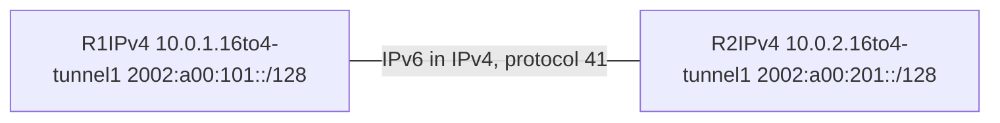

# 6to4

> 6to4 in RouterOS: carry IPv6 over an IPv4 network, connect two IPv6 networks with a tunnel, allow IP protocol 41 in the firewall, and get IPv6 from a tunnel broker.

# 6to4

A 6to4 interface carries IPv6 packets inside IPv4 packets (IP protocol 41). Use it to connect IPv6 networks over a network that has only IPv4, for example to get IPv6 from a tunnel broker when your internet provider has none. The interface works in two modes:

- With `remote-address`, it is a tunnel to one IPv4 address. All IPv6 packets that are routed to the interface go to that address.
- Without `remote-address`, the router takes the IPv4 destination from the IPv6 destination address. This works for addresses in 2002::/16, where the 32 bits after 2002 are an IPv4 address.

The tunnel does not encrypt the traffic. Both routers need IPv4 addresses that the other one can reach: over the internet, these must be public addresses.

## Connect two IPv6 networks

In this example the office router has the IPv4 address 203.0.113.1 and the branch router 203.0.113.2. The tunnel itself uses the IPv6 network 2001:db8:ffff::/64.

On the office router:

```ros
/interface/6to4/add name=6to4-branch local-address=203.0.113.1 \
    remote-address=203.0.113.2
/ipv6/address/add address=2001:db8:ffff::1/64 advertise=no \
    interface=6to4-branch
```

On the branch router:

```ros
/interface/6to4/add name=6to4-office local-address=203.0.113.2 \
    remote-address=203.0.113.1
/ipv6/address/add address=2001:db8:ffff::2/64 advertise=no \
    interface=6to4-office
```

Each router can now ping the other one, for example `/ping 2001:db8:ffff::2` on the office router.

```ros
[admin@Server] > /interface/6to4/print detail
Flags: R - RUNNING
0 R name="6to4-branch" mtu=auto actual-mtu=1480 local-address=203.0.113.1
    remote-address=203.0.113.2 dscp=inherit clamp-tcp-mss=yes dont-fragment=no
```

To reach the IPv6 network behind the other router, add a route. The branch LAN in this example is 2001:db8:b::/64:

```ros
/ipv6/route/add dst-address=2001:db8:b::/64 gateway=2001:db8:ffff::2
```

- The MTU of the interface is 1480 bytes: the IPv4 header takes 20 bytes.
- `keepalive=10s,3` sends a keepalive packet every 10 seconds and removes the running flag of the interface after 3 packets without an answer. Routes through the interface then become inactive.

## Allow the tunnel in the firewall

The default firewall drops the packets of the tunnel that come from the internet. Accept IP protocol 41 from the address of the other router, before the default drop rule:

```ros
/ip/firewall/filter/add chain=input action=accept \
    protocol=ipv6-encap src-address=203.0.113.2 \
    comment="accept 6to4" \
    place-before=[find comment="defconf: drop all not coming from LAN"]
```

The IPv6 packets from the tunnel then pass the IPv6 firewall of the router as packets from the 6to4 interface. Check that the IPv6 firewall rules treat this interface as you intend.

## Get IPv6 from a tunnel broker

A tunnel broker gives you an IPv6 connection through a 6to4 tunnel. This example uses the [Hurricane Electric Tunnel Broker](https://tunnelbroker.net). You need a public IPv4 address, and the broker must be able to ping it.

When you create a tunnel, the broker shows the addresses of the tunnel and a routed /64 prefix for your network:


The broker also shows ready commands for RouterOS in its "Example Configurations". In this example your public IPv4 address is 194.105.56.170:

```ros
/interface/6to4/add name=sit1 mtu=1280 \
    local-address=194.105.56.170 remote-address=216.66.80.90 \
    comment="Hurricane Electric IPv6 Tunnel Broker"
/ipv6/route/add dst-address=2000::/3 gateway=2001:470:27:37e::1
/ipv6/address/add address=2001:470:27:37e::2/64 advertise=no \
    interface=sit1
```

The router now reaches IPv6 hosts, but the devices of the LAN do not. Give the LAN bridge an address from the routed prefix, and announce it to the devices:

```ros
/ipv6/address/add address=2001:470:28:37e::/64 interface=bridge \
    advertise=yes
```

Announce a DNS server to the devices, and give the router IPv6 DNS servers. These are the public DNS servers of Google; the broker has its own at 2001:470:20::2:

```ros
/ipv6/nd/set [find default=yes] advertise-dns=yes
/ip/dns/set allow-remote-requests=yes \
    servers=2001:4860:4860::8888,2001:4860:4860::8844
```

:::warning
With a public IPv6 prefix, every device of the LAN has an address that the internet can reach. Check that the IPv6 firewall of the router protects the LAN before you announce the prefix: see [IPv6 firewall](../firewall-and-quality-of-service/firewall/).
:::

Open [https://test-ipv6.com](https://test-ipv6.com/) on a device of the LAN to test the connection.

## Automatic 6to4 addresses

Without `remote-address`, an interface needs no tunnel for each destination. Each router makes its IPv6 address from its IPv4 address: 2002, then the IPv4 address in hexadecimal. For 10.0.1.1 this is 2002:a00:101::, and for 10.0.2.1 it is 2002:a00:201::.

:::warning
This mode does not pass traffic at present: the routers send the packets, but do not accept the packets that they receive. Use `remote-address`.
:::

In this example each router makes its 6to4 address from its IPv4 address, and both route 2002::/16 to the 6to4 interface:



On the first router:

```ros
/interface/6to4/add name=6to4-tunnel1
/ipv6/address/add address=2002:a00:101::/128 advertise=no \
    interface=6to4-tunnel1
/ipv6/route/add dst-address=2002::/16 gateway=6to4-tunnel1
```

On the second router:

```ros
/interface/6to4/add name=6to4-tunnel1
/ipv6/address/add address=2002:a00:201::/128 advertise=no \
    interface=6to4-tunnel1
/ipv6/route/add dst-address=2002::/16 gateway=6to4-tunnel1
```

## Read more

- [`/interface/6to4`](../cli-reference/interface/6to4)
- [GRE](gre), [IPIP](ipip): other tunnels that can carry IPv6
