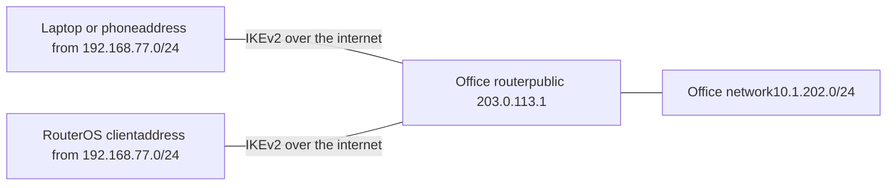
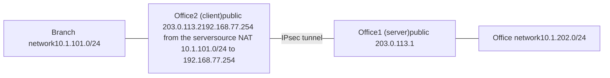

# Road warrior with certificates

> IKEv2 road warrior server with certificates in RouterOS: create the certificates, configure the server, give clients addresses and routes with mode config, and connect RouterOS, Windows, macOS, iOS, Android and Linux...

# Road warrior with certificates

A road warrior is a remote device, such as a laptop, a phone or a small router, that connects to the office from any place on the internet. This page sets up a RouterOS IKEv2 server that authenticates the clients with certificates, and the clients for RouterOS and other systems.

In the examples, the office router has the public address 203.0.113.1 and the network 10.1.202.0/24 behind it. The clients get addresses from 192.168.77.0/24:



To let users log in with a user name and a password in place of a certificate for each device, see [Road warrior with EAP and User Manager](road-warrior-ikev2-eap).

## Server

### Certificates

The server needs a certificate, and each client needs one. This example makes them on the router with its own certificate authority (CA); you can also use a separate CA. [Certificates](../../authentication-authorization-accounting/certificates) explains the commands.

The server certificate must meet these conditions, or some clients do not connect:

- The common name is the IP address or the DNS name of the server.
- The subject alternative name (SAN) has the IP address or the DNS name of the server.
- The key usage has `tls-server`. A client certificate has `tls-client`.

```ros
/certificate
add name=ca common-name=ca key-usage=key-cert-sign,crl-sign
sign ca ca-crl-host=203.0.113.1
add name=server1 common-name=203.0.113.1 \
    subject-alt-name=IP:203.0.113.1 key-usage=tls-server
sign server1 ca=ca
add name=rw-client1 common-name=rw-client1 key-usage=tls-client
sign rw-client1 ca=ca
```

### IPsec configuration

Add a profile and a proposal. `pfs-group=none` avoids problems with clients of other vendors:

```ros
/ip/ipsec/profile/add name=ike2
/ip/ipsec/proposal/add name=ike2 pfs-group=none
```

Add a pool for the client addresses and a mode config that gives each client an address from it:

```ros
/ip/pool/add name=ike2-pool ranges=192.168.77.2-192.168.77.254
/ip/ipsec/mode-config/add name=ike2-conf address-pool=ike2-pool \
    address-prefix-length=32
```

Add a policy group and a policy template. The template limits the dynamic policies to the client addresses:

```ros
/ip/ipsec/policy/group/add name=ike2-policies
/ip/ipsec/policy/add template=yes group=ike2-policies \
    proposal=ike2 src-address=0.0.0.0/0 dst-address=192.168.77.0/24
```

Add a peer that listens for all IKEv2 connections, and an identity that accepts every client with a certificate that the CA signed:

```ros
/ip/ipsec/peer/add name=ike2 exchange-mode=ike2 passive=yes \
    profile=ike2
/ip/ipsec/identity/add peer=ike2 auth-method=digital-signature \
    certificate=server1 generate-policy=port-strict \
    mode-config=ike2-conf policy-template-group=ike2-policies
```

In the firewall, accept IKE and ESP from the internet: see [Firewall and routing for IPsec](firewall-and-routing) for the rules.

When a client is connected, the server shows it with the name of its certificate and the address that it got:

```ros
[admin@Office1] > /ip/ipsec/active-peers/print
Flags: R - RESPONDER
Columns: ID, STATE, UPTIME, PH2-TOTAL, REMOTE-ADDRESS, DYNAMIC-ADDRESS
#   ID             STATE        UPTIME  P  REMOTE-ADDRESS  DYNAMIC-ADDRESS
0 R CN=rw-client1  established  2m16s   1  203.0.113.2     192.168.77.254 
```

### Different settings for one client

An identity can match one client and give it other settings. This example gives the client with the certificate `rw-client1` a fixed address and access to one network. Add a mode config and a policy template for the address:

```ros
/ip/ipsec/mode-config/add name=usr-a address=192.168.66.2 \
    address-prefix-length=32 split-include=10.1.202.0/24 \
    system-dns=no
/ip/ipsec/policy/add template=yes group=ike2-policies \
    proposal=ike2 src-address=0.0.0.0/0 dst-address=192.168.66.0/24
```

Add an identity that matches the certificate:

```ros
/ip/ipsec/identity/add peer=ike2 auth-method=digital-signature \
    certificate=server1 generate-policy=port-strict \
    match-by=certificate remote-certificate=rw-client1 \
    mode-config=usr-a policy-template-group=ike2-policies
```

:::warning
If the ID that a client sends (ID\_i) does not match its certificate, the server finds no identity for it. See `remote-id` in the [identity reference](../../cli-reference/ip/ipsec/identity).
:::

### Split tunnel and DNS

By default a client sends all its traffic through the tunnel. With a split tunnel, the client sends only the traffic for the office networks through the tunnel and the rest directly to the internet. Set the office networks in `split-include` of the mode config:

```ros
/ip/ipsec/mode-config/set [find name=ike2-conf] \
    split-include=10.1.202.0/24
```

The server also sends DNS servers to the client. With `system-dns=yes` (the default) these are the DNS servers of the router. To send another one:

```ros
/ip/ipsec/mode-config/set [find name=ike2-conf] system-dns=no \
    static-dns=10.1.202.1
```

A split tunnel is not a security measure: a client can still ask for other networks in phase 2. Do not narrow the policy template to the split networks, because this breaks clients of some vendors. Limit the access with the firewall:

```ros
/ip/firewall/filter/add chain=forward action=drop \
    src-address=192.168.77.0/24 dst-address=!10.1.202.0/24 \
    place-before=[find comment="defconf: accept in ipsec policy"]
```

The rule must be before the rule of the default configuration that accepts all traffic from IPsec policies, or it never matches. For a client with its own address, such as 192.168.66.2 in the example of one client, add a rule of the same kind with that address. To allow one server only, use its address in `dst-address`, for example `dst-address=!10.1.202.10`.

### Export the client certificates

Most clients take a PKCS12 file, which has the certificate and its private key:

```ros
/certificate/export-certificate rw-client1 type=pkcs12 \
    export-passphrase=Example-p12-pass-1 file-name=rw-client1
```

The file `rw-client1.p12` is now in the [files](../../system-information-and-utilities/files) of the router. A PKCS12 file also has the CA certificate, but some systems do not install it from there. Export the CA certificate separately for them:

```ros
/certificate/export-certificate ca file-name=ca
```

For software that does not take PKCS12, export the client certificate in PEM format. This writes a `.crt` file and a `.key` file:

```ros
/certificate/export-certificate rw-client1 \
    export-passphrase=Example-p12-pass-1 file-name=rw-client1
```

Send the files to the client in a safe way: they have the private key of the client.

### Known limits of clients

- Windows ignores the networks of `split-include` and asks for a policy to 0.0.0.0/0. After the SA is made, Windows asks for DHCP option 249, and RouterOS answers with the `split-include` networks.
- macOS and iOS accept only the first `split-include` network.
- macOS and iOS use the DNS servers of `system-dns` and `static-dns` only when `split-include` is 0.0.0.0/0.
- Some clients can use another PFS group in phase 2. Use `pfs-group=none` in the proposal to avoid problems.

## RouterOS client

Copy the PKCS12 file to the client router and import it:

```ros
/certificate/import file-name=rw-client1.p12 name=rw-client1 \
    passphrase=Example-p12-pass-1
```

The import adds two certificates with the same name: the client certificate (flag `K`, it has the private key) and the CA certificate. Give the CA another name, or the identity can select the wrong one and the connection fails with `can't get private key` in the log:

```ros
/certificate/set [find common-name=ca] name=ca
```

Add a profile, a proposal, a policy group and a template of their own, so that this connection does not depend on other IPsec configuration of the router:

```ros
/ip/ipsec/profile/add name=ike2-rw
/ip/ipsec/proposal/add name=ike2-rw pfs-group=none
/ip/ipsec/policy/group/add name=ike2-rw
/ip/ipsec/policy/add template=yes group=ike2-rw proposal=ike2-rw
```

Add a mode config that asks the server for the settings, the peer and the identity:

```ros
/ip/ipsec/mode-config/add name=ike2-rw responder=no
/ip/ipsec/peer/add name=office address=203.0.113.1/32 \
    exchange-mode=ike2 profile=ike2-rw
/ip/ipsec/identity/add peer=office auth-method=digital-signature \
    certificate=rw-client1 generate-policy=port-strict \
    mode-config=ike2-rw policy-template-group=ike2-rw
```

The client is connected when the peer is `established`:

```ros
[admin@Office2] > /ip/ipsec/active-peers/print
Columns: ID, STATE, UPTIME, PH2-TOTAL, REMOTE-ADDRESS
# ID           STATE        UPTIME  PH2-TOTAL  REMOTE-ADDRESS
0 203.0.113.1  established  2m16s           1  203.0.113.1   
```

The client has the address from the server, and a dynamic policy from this address to each network that the server sent:

```ros
[admin@Office2] > /ip/ipsec/policy/print detail
Flags: T - TEMPLATE; D - DYNAMIC, A - ACTIVE; * - DEFAULT
0  T * group=default src-address=::/0 dst-address=::/0 protocol=all
       proposal=default template=yes
 
1  T   group=ike2-rw src-address=::/0 dst-address=::/0 protocol=all
       proposal=ike2-rw template=yes
 
2   D  peer=office tunnel=yes group=ike2-rw src-address=192.168.77.254/32
       src-port=any dst-address=10.1.202.0/24 dst-port=any protocol=all
       action=encrypt level=unique ipsec-protocols=esp
       sa-src-address=203.0.113.2 sa-dst-address=203.0.113.1 proposal=ike2-rw
       ph2-count=1 ph2-state=established
```

### Let the network behind the client use the tunnel

The dynamic policy matches only packets from the address that the server gave, 192.168.77.254 in this example. The devices of the network behind the client router have other addresses, so their packets do not match. The address from the server can change, so a static source NAT rule does not help.



RouterOS can add the source NAT rule dynamically. Put the local networks into an address list and name the list in the mode config:

```ros
/ip/firewall/address-list/add address=10.1.101.0/24 list=local
/ip/ipsec/mode-config/set [find name=ike2-rw] src-address-list=local
```

When the tunnel is made again, a dynamic rule changes the source address of the packets from the list to the address from the server, for each network of the tunnel:

```ros
[admin@Office2] > /ip/firewall/nat/print
Flags: D - DYNAMIC
0 D ;;; ipsec mode-config
    chain=srcnat action=src-nat to-addresses=192.168.77.254
    dst-address=10.1.202.0/24 src-address-list=local dst-address-list=!local
 
1   chain=srcnat action=masquerade out-interface=ether2
```

:::warning
The address that the server gives must not be inside a local network of the client.
:::

## Windows client

Open the PKCS12 file on the Windows computer and follow the steps to install the certificate. Select the **Local Machine** store.


In **Network and Internet** settings, open **VPN** and add a connection: give it a name, the address of the server, and select **IKEv2** as the VPN type. Then open the properties of the connection in the **Network and Sharing Center**, and on the **Security** tab select **Use machine certificates**.


Windows 10 is compatible with the following Phase 1 (profiles) and Phase 2 (proposals) proposal sets:

| Phase 1 |  |  |
| :-- | :-- | :-- |
| Hash Algorithm | Encryption Algorithm | DH Group |
| SHA1 | 3DES | modp1024 |
| SHA256 | 3DES | modp1024 |
| SHA1 | AES-128-CBC | modp1024 |
| SHA256 | AES-128-CBC | modp1024 |
| SHA1 | AES-192-CBC | modp1024 |
| SHA256 | AES-192-CBC | modp1024 |
| SHA1 | AES-256-CBC | modp1024 |
| SHA256 | AES-256-CBC | modp1024 |
| SHA1 | AES-128-GCM | modp1024 |
| SHA256 | AES-128-GCM | modp1024 |
| SHA1 | AES-256-GCM | modp1024 |
| SHA256 | AES-256-GCM | modp1024 |

| Phase 2 |  |  |
| :-- | :-- | :-- |
| Hash Algorithm | Encryption Algorithm | PFS Group |
| SHA1 | AES-256-CBC | none |
| SHA1 | AES-128-CBC | none |
| SHA1 | 3DES | none |
| SHA1 | DES | none |
| SHA1 | none | none |

## macOS client

Open the PKCS12 file on the Mac and install the certificate in the **System** keychain. The CA certificate is self-signed, so mark it as trusted by hand: in the Keychain Access application, find the certificate under **System** and set it to **Always Trust**.


In **System Preferences**, open **Network** and add a configuration with the **+** button: interface **VPN**, VPN type **IKEv2**. **Remote ID** must be the common name or the subject alternative name of the server certificate. **Local ID** can be empty. In **Authentication Settings** select **None** and choose the client certificate.


macOS is compatible with the following Phase 1 (profiles) and Phase 2 (proposals) proposal sets:

| Phase 1 |  |  |
| :-- | :-- | :-- |
| Hash Algorithm | Encryption Algorithm | DH Group |
| SHA256 | AES-256-CBC | modp2048 |
| SHA256 | AES-256-CBC | ecp256 |
| SHA256 | AES-256-CBC | modp1536 |
| SHA1 | AES-128-CBC | modp1024 |
| SHA1 | 3DES | modp1024 |

| Phase 2 |  |  |
| :-- | :-- | :-- |
| Hash Algorithm | Encryption Algorithm | PFS Group |
| SHA256 | AES-256-CBC | none |
| SHA1 | AES-128-CBC | none |
| SHA1 | 3DES | none |

## iOS client

iOS does not install the CA certificate from a PKCS12 file, so send the CA certificate to the device as a separate PEM file. Open both files on the device and install the certificates. Then mark the CA certificate as trusted in **Settings**, **General**, **About**, **Certificate Trust Settings**. Check in **Settings**, **General**, **Profiles** that both certificates are shown as verified.


In **Settings**, **General**, **VPN**, add a configuration. **Remote ID** must be the common name or the subject alternative name of the server certificate. **Local ID** can be empty.


iOS is compatible with the following Phase 1 (profiles) and Phase 2 (proposals) proposal sets:

| Phase 1 |  |  |
| :-- | :-- | :-- |
| Hash Algorithm | Encryption Algorithm | DH Group |
| SHA256 | AES-256-CBC | modp2048 |
| SHA256 | AES-256-CBC | ecp256 |
| SHA256 | AES-256-CBC | modp1536 |
| SHA1 | AES-128-CBC | modp1024 |
| SHA1 | 3DES | modp1024 |

| Phase 2 |  |  |
| :-- | :-- | :-- |
| Hash Algorithm | Encryption Algorithm | PFS Group |
| SHA256 | AES-256-CBC | none |
| SHA1 | AES-128-CBC | none |
| SHA1 | 3DES | none |

:::warning
An iOS device that is connected to the VPN over Wi-Fi can go to sleep and disconnect from the network.
:::

## Android client (strongSwan)

Use the strongSwan application from the Google Play Store. Copy the PKCS12 file to the device. In strongSwan, add a VPN profile, enter the address of the server and select **IKEv2 Certificate** as the VPN type. For the user certificate, press **Install** and select the PKCS12 file. Save the profile and press it to connect.


You can specify custom encryption settings in strongSwan by ticking the "Show advanced settings" checkbox. StrongSwan by default is compatible with the following Phase 1 (profiles) and Phase 2 (proposals) proposal sets:

| Phase 1 |  |  |
| :-- | :-- | :-- |
| Hash Algorithm | Encryption Algorithm | DH Group |
| SHA\* | AES-\*-CBC | modp2048 |
| SHA\* | AES-\*-CBC | ecp256 |
| SHA\* | AES-\*-CBC | ecp384 |
| SHA\* | AES-\*-CBC | ecp521 |
| SHA\* | AES-\*-CBC | modp3072 |
| SHA\* | AES-\*-CBC | modp4096 |
| SHA\* | AES-\*-CBC | modp6144 |
| SHA\* | AES-\*-CBC | modp8192 |
| SHA\* | AES-\*-GCM | modp2048 |
| SHA\* | AES-\*-GCM | ecp256 |
| SHA\* | AES-\*-GCM | ecp384 |
| SHA\* | AES-\*-GCM | ecp521 |
| SHA\* | AES-\*-GCM | modp3072 |
| SHA\* | AES-\*-GCM | modp4096 |
| SHA\* | AES-\*-GCM | modp6144 |
| SHA\* | AES-\*-GCM | modp8192 |

| Phase 2 |  |  |
| :-- | :-- | :-- |
| Hash Algorithm | Encryption Algorithm | PFS Group |
| none | AES-256-GCM | none |
| none | AES-128-GCM | none |
| SHA256 | AES-256-CBC | none |
| SHA512 | AES-256-CBC | none |
| SHA1 | AES-256-CBC | none |
| SHA256 | AES-192-CBC | none |
| SHA512 | AES-192-CBC | none |
| SHA1 | AES-192-CBC | none |
| SHA256 | AES-128-CBC | none |
| SHA512 | AES-128-CBC | none |
| SHA1 | AES-128-CBC | none |

## Linux client (strongSwan)

Copy the PKCS12 file to the directory `/etc/ipsec.d/private`.

Add the passphrase of the file to `/etc/ipsec.secrets`. In this line `strongSwan_client.p12` is the file name:

```bash
: P12 strongSwan_client.p12 "Example-p12-pass-1"
```

Add a connection to `/etc/ipsec.conf`:

```bash
conn "ikev2"
keyexchange=ikev2
ike=aes128-sha1-modp2048
esp=aes128-sha1
leftsourceip=%modeconfig
leftcert=strongSwan_client.p12
leftfirewall=yes
right=203.0.113.1
rightid="CN=203.0.113.1"
rightsubnet=0.0.0.0/0
auto=add
```

Restart the IPsec service and start the connection:

```bash
ipsec restart
ipsec up ikev2
```

RouterOS does not support IKEv2 reauthentication (RFC 4478). If strongSwan shows `initiator did not reauthenticate as requested`, disable reauthentication in strongSwan.

## Read more

- [IPsec](./): how IKE works, the menus, the algorithms
- [Road warrior with EAP and User Manager](road-warrior-ikev2-eap)
- [Certificates](../../authentication-authorization-accounting/certificates)
- [Troubleshooting](troubleshooting)
