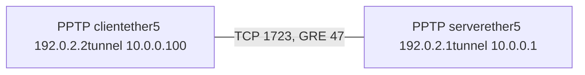

# PPTP

> PPTP is a legacy VPN protocol that carries a PPP session over TCP 1723 and GRE. The page covers a router-to-router client and server example, PPP authentication and encryption profiles, MTU, static and dynamic server...

# PPTP

PPTP (Point-to-Point Tunneling Protocol) is a legacy VPN protocol that carries a PPP session
between a client and a server. RouterOS can be either end: [`/interface/pptp-client`](../cli-reference/interface/pptp-client/)
connects to a remote server, and [`/interface/pptp-server`](../cli-reference/interface/pptp-server/)
accepts clients. PPTP is built into Windows and many older devices, so it is still used where
compatibility is the main requirement.

:::warning
PPTP is not secure. Its authentication and encryption mechanisms are weak by current standards,
and implementations have a history of vulnerabilities. An exposed PPTP server is a security risk;
keep RouterOS up to date and use PPTP only for legacy clients. For new deployments, use
[L2TP/IPsec](./l2tp/), [SSTP](./sstp), [OpenVPN](./openvpn) or [WireGuard](./wireguard).
:::

PPTP runs over IPv4. The control connection uses TCP port 1723, and the tunneled PPP frames travel
in GRE (IP protocol 47). Both must be allowed between the endpoints. The PPP session can carry IPv4
and IPv6 traffic, according to the PPP profile.

Authentication, encryption and accounting come from PPP. Users are configured in `/ppp/secret` or
on a RADIUS server, and the session options come from a
[PPP profile](../authentication-authorization-accounting/ppp-aaa).
The default `default-encryption` profile enables MPPE encryption, which requires MSCHAP
authentication; the `default` profile does not encrypt. See
[PPP AAA](../authentication-authorization-accounting/ppp-aaa) for RADIUS.

## How PPTP works

The client opens a TCP connection to the server on port 1723 and establishes the tunnel. The
tunneled PPP frames are then exchanged in GRE packets. On the server, each connected user is served
by a PPP interface: a dynamic interface, or the static entry for that user. The client entry also
creates an interface; it is running (flag `R`) only while the tunnel is connected.

Both ends have a maximum transmit and receive unit (`max-mtu` and `max-mru`), 1450 by default. When
the values differ, the tunnel comes up with the lower value. The client's
`/interface/pptp-client/monitor` shows the negotiated MTU, the encryption, and the local and remote
tunnel addresses.

## Example: two routers

This example connects RouterOS as a PPTP client to RouterOS as a PPTP server over an IPv4 link.
ether5 on the client has 192.0.2.2/24 and ether5 on the server has 192.0.2.1/24; the tunnel uses
10.0.0.100 for the client and 10.0.0.1 for the server.



### Server

Enable the PPTP server and create a PPP secret for the client:

```ros
/interface/pptp-server/server/set enabled=yes
/ppp/secret/add name=pptp-test password=<password> service=pptp \
    profile=default-encryption local-address=10.0.0.1 \
    remote-address=10.0.0.100
```

The server listens on TCP port 1723. The secret supplies the user name, password and tunnel
addresses; in the secret, `local-address` is the server's end of the tunnel and `remote-address`
is the client's end. The PPP profile supplies authentication and encryption settings. The server
accepts MSCHAP1 and MSCHAP2 by default; the `authentication` setting in
`/interface/pptp-server/server` changes that. A client that does not support MPPE can use the
`default` profile with an authentication method it supports, such as PAP; the tunnel then comes up
without encryption. A user can also be authenticated through RADIUS.

### Client

Create the client entry with the server address and the same credentials:

```ros
/interface/pptp-client/add connect-to=192.0.2.1 name=pptp-out1 user=pptp-test \
    password=<password> profile=default-encryption disabled=no
```

A new PPTP client is disabled by default, so `disabled=no` is needed to start it. Check the
interface:

```ros
/interface/pptp-client/print
Flags: R - RUNNING
0 R name="pptp-out1" max-mtu=1450 max-mru=1450 mrru=disabled
    connect-to=192.0.2.1 user="pptp-test" profile=default-encryption
    keepalive-timeout=60 use-peer-dns=no add-default-route=no dial-on-demand=no
    allow=pap,chap,mschap1,mschap2
```

The server shows a dynamic interface for the connected user:

```ros
/interface/pptp-server/print
Flags: D - DYNAMIC; R - RUNNING
Columns: NAME, USER, MTU, CLIENT-ADDRESS, UPTIME, ENCODING
#    NAME              USER        MTU  CLIENT-ADDRESS  UPTIME  ENCODING
0 DR <pptp-pptp-test>  pptp-test  1450  192.0.2.2      4s      MPPE128 stateless
```

The `CLIENT-ADDRESS` column is the client's outer IPv4 address (192.0.2.2), not its tunnel address.

The client can reach the server's tunnel address:

```ros
/ping 10.0.0.1 count=3
  SEQ HOST                                     SIZE TTL TIME       STATUS
    0 10.0.0.1                                   56  64 469us
    1 10.0.0.1                                   56  64 374us
    2 10.0.0.1                                   56  64 350us
    sent=3 received=3 packet-loss=0% min-rtt=350us avg-rtt=397us
   max-rtt=469us
```

A route to the peer's tunnel address (`10.0.0.1/32`) is added automatically. To reach the server's
LAN, add a route to that network through the tunnel. To route all traffic through the tunnel, use
`add-default-route=yes` on the client. This adds an IPv4 default route and does not change DNS; set
`use-peer-dns=yes` if the client should also use the DNS servers from the peer.

### Static and dynamic server interfaces

A dynamic interface exists only while the user is connected. It is named after the user, for
example `<pptp-pptp-test>`, so it disappears on disconnect and cannot be referenced in
configuration.

When a firewall rule or another configuration needs a stable interface name, add a static entry on
the server for that user:

```ros
/interface/pptp-server/add name=pptp-in1 user=pptp-test
```

The static interface exists whether the user is connected or not, and the server uses it instead of
a dynamic interface when that user connects. If the user already has an active session through the
static interface, a second connection gets a dynamic interface, because two interfaces cannot share
the name. A static entry only names the interface; the user must still exist in `/ppp/secret` or
RADIUS, otherwise authentication fails.

## Firewall

The server must accept TCP port 1723 and GRE from the client. The client must accept GRE from the
server. On a default configuration, the input chain ends with a drop rule for traffic that does not
come from the LAN, so the rules must be placed ahead of it:

```ros
/ip/firewall/filter/add chain=input protocol=tcp dst-port=1723 action=accept \
    place-before=[find comment="defconf: drop all not coming from LAN"]
/ip/firewall/filter/add chain=input protocol=gre action=accept \
    place-before=[find comment="defconf: drop all not coming from LAN"]
```

On a router without that rule, place the two rules before whatever rule drops the traffic. These
are the server's rules; on the client, only the GRE rule is needed. On a router with a default
configuration, the input chain accepts established and related traffic, but GRE is a separate
protocol; from the WAN it is dropped unless it is accepted explicitly. Restrict the rules to the
WAN interface or the peer address when possible.

If the PPTP server is behind NAT, both TCP 1723 and GRE must reach it. Not every NAT device
forwards GRE correctly; a public address for the server avoids the problem. Traffic from clients
that the server forwards to its LAN passes through the forward chain and needs forwarding rules and
routes like any other traffic.

## MTU

The tunnel MTU defaults to 1450 on both ends. PPTP does not discover the path MTU, so choose a
value that fits the path between the endpoints. Set `max-mtu` on either end to change it; when the
two values differ, the tunnel comes up with the lower one. A client with `max-mtu=1400` brings the
tunnel up with MTU 1400 even when the server allows 1450.

Lower the MTU when large packets stall or connections open but data transfers fail, for example
when the path between the endpoints has a smaller MTU than 1500. A PPP profile can also change the
TCP MSS to fit the tunnel MTU (`change-tcp-mss`).

## Troubleshooting

### The client does not connect

- **The client is disabled.** A newly added PPTP client has `disabled=yes`; enable it in the
  client entry. The client shows the `R` flag only when it is connected.
- **TCP port 1723 is blocked.** The client does not connect and the interface has no `R` flag.
  Check the input chain on the server and the counters on any rule that drops TCP 1723.
- **The credentials are wrong.** The server log reports `user <name> authentication failed`. Check
  the `/ppp/secret` entry or the RADIUS server.
- **The server is not enabled.** Check `/interface/pptp-server/server/print`; `enabled` must be
  `yes`.

### The tunnel is up but no traffic passes

- **GRE is blocked at either end.** The TCP control connection stays up and the interface keeps the
  `R` flag, but pings and other data time out. Check the input chain on both routers for a rule that
  drops `protocol=gre`; `/ip/firewall/filter/print stats` shows whether the rule matches.
- **No route to the remote network.** The router adds a /32 route for the peer's tunnel address.
  A remote LAN needs its own route through the tunnel, or `add-default-route=yes` on the client.
- **The forward chain blocks the traffic.** Traffic that the server forwards between the tunnel and
  its LAN passes through the forward chain.
- **The MTU is too high for the path.** Small packets pass, but large ones stall. Lower
  `max-mtu` on the client or server.

### Large packets stall

Lower `max-mtu` on either end and check the PPP profile's TCP MSS setting (`change-tcp-mss`). The
tunnel comes up with the lower of the client and server MTU values.

## Technical details

PPTP carries a PPP session: the control connection manages the call over TCP 1723, and the PPP
frames travel in GRE. Authentication and encryption are PPP features, not PPTP features, so the
same secrets, profiles and RADIUS settings work for PPTP, L2TP, PPPoE and other PPP services.

MPPE encryption is derived from the MSCHAP authentication exchange. With the `default` profile and
a server that allows only PAP, the tunnel comes up without encryption; the client's monitor shows an
empty `encoding` field in that case.

Because PPTP runs over IPv4 GRE, the outer packets cannot use IPv6. The PPP session can still carry
IPv6 traffic when the PPP profile enables it.

The menu and its arguments are described in the
[`/interface/pptp-client`](../cli-reference/interface/pptp-client/),
[`/interface/pptp-server`](../cli-reference/interface/pptp-server/) and
[`/interface/pptp-server/server`](../cli-reference/interface/pptp-server/server) CLI references.
