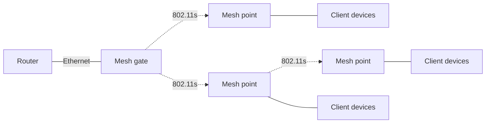

# Configuring MeshPoint

> Configure an IEEE 802.11s MeshPoint network in RouterOS: set the Mesh ID and WPA3-PSK security, bridge the mesh and AP interfaces, and verify peer links.

# Configuring MeshPoint

**Package:** `wifi-qcom-be`, `wifi-mediatek`

:::warning

- MeshPoint works on `wifi-qcom-be` and `wifi-mediatek`. It does not work on `wifi-qcom` or `wifi-qcom-ac`.
- MeshPoint is configured in the CLI. GUI support is not available.
- The mesh peer link uses WPA3-PSK (SAE). WPA2-PSK is not supported for 802.11s.

:::

MeshPoint is the RouterOS implementation of an IEEE 802.11s Layer 2 mesh. Use it to connect access points without Ethernet cabling and extend a Layer 2 network over multiple wireless hops.

Mesh nodes discover each other over Wi-Fi by Mesh ID and form WPA3-PSK (SAE) peer links. WPA2-PSK is not supported for the mesh link. MeshPoint self-heals: it chooses the lowest-cost path and reroutes traffic when a link fails.

Every device in the mesh is a mesh node. A mesh gate is a node with a wired uplink to the LAN; it announces the path to the wired network over Wi-Fi, so other nodes can reach the LAN and internet. Nodes without a wired uplink form wireless peer links with each other and forward client traffic over one or more wireless hops to a mesh gate. A mesh can have more than one gate. Each node can also run a normal AP interface for local clients; clients connect to that AP, not to the mesh link. The mesh, AP, and Ethernet interfaces are bridged together, so clients see one Layer 2 network.

The mesh link is the backhaul between nodes. The AP interface is the fronthaul for clients.

In simple terms:

- All ports of the mesh node are bridged. Every node uses the same Mesh ID (`configuration.ssid`) and WPA3-PSK passphrase.
- The Wi-Fi interface used for the mesh link (for example, `wifi1`) runs in MeshPoint mode.
- A second Wi-Fi interface (for example, `wifi2`) runs in AP mode, so client devices can reach the LAN through the mesh.
- Client traffic is forwarded from node to node until it reaches a node with a wired uplink.
- The mesh automatically reroutes traffic if a link fails.

## Topology

A MeshPoint network has these roles:

- Mesh gate - a mesh node with an Ethernet uplink to the LAN. It announces the path to the wired network with HWMP Root Announcements (RANN).
- Mesh point - a node that joins the mesh by Mesh ID and forwards traffic over peer links. It can serve local clients with an AP interface.

All nodes use the same Mesh ID, WPA3-PSK passphrase, and country settings. The radios must support a common band and channel. The mesh forwards Ethernet frames at Layer 2, so all nodes are in the same Layer 2 network and client MAC addresses are preserved across hops.



A mesh point peers with every neighbor in range. HWMP selects the active path to the mesh gate by comparing the airtime link metric of each path: data rate, frame error rate, and channel overhead. The path with the lowest total metric is used. Multiple mesh gates can be present, and each node selects the best path to a gate. If a link fails, HWMP reroutes traffic.

:::warning

Path selection cannot remove interference, and every extra hop reduces throughput and adds latency.

In a single-radio mesh, all nodes share one channel and its airtime. For example, in a 3-hop chain A-B-C-D, a frame from D to A is transmitted three times on the same channel: D→C, C→B, B→A. Only one node can transmit at a time, so every hop consumes the same airtime again. Throughput drops roughly by half per hop. Hidden-node collisions and nearby APs on the same channel make long chains worse.

For long chains, use 5 GHz for the mesh backhaul, fewer hops, or wired uplinks.

:::

## Configuration

:::warning
Wi-Fi and bridge changes can interrupt the management connection. Connect through an Ethernet port or use the [Winbox](../../management-tools/winbox.md) Neighbors tab by MAC address.
:::

A mesh gate can be the router with a DHCP server, or a Layer 2 access point that bridges the mesh to the LAN. A mesh node is an access point and bridges client traffic into the mesh through its MeshPoint Wi-Fi interface.

If the mesh gate is a router with a DHCP server, make sure the required LAN Ethernet ports, the MeshPoint Wi-Fi interface, and the AP Wi-Fi interface are in the same bridge.

If the mesh gate is a pure Layer 2 AP, make sure all ports (Ethernet, Wi-Fi MeshPoint, and AP) are bridged together and that the bridge has an IP address, either assigned manually or obtained with DHCP.

There are no other configuration differences between the mesh gate and the mesh node. Configure the MeshPoint Wi-Fi interface identically on the mesh gate and the mesh node (just make sure that Wi-Fi interfaces are put into correct bridges).

### MeshPoint interface

Set one radio to MeshPoint mode:

```ros
/interface/wifi
set [find default-name=wifi1] configuration.country=Latvia .mode=meshpoint .ssid=mesh-mesh datapath.bridge=bridge disabled=no security.authentication-types=wpa3-psk .passphrase=mesh-password
```

- `configuration.mode=meshpoint` - selects IEEE 802.11s MeshPoint mode.
- `configuration.ssid=mesh-mesh` - sets the Mesh ID. This value is not a client SSID.
- `configuration.country=Latvia` - sets the regulatory domain. Use your country.
- `security.authentication-types=wpa3-psk` - authenticates mesh peers with SAE.
- `security.passphrase=mesh-password` - sets the mesh password. Use the same password on every node.
- `datapath.bridge=bridge` - adds the mesh interface to the bridge.

Apply the same MeshPoint Wi-Fi interface configuration on every mesh gate and mesh node so that every device in the network has one of its interfaces configured as a MeshPoint.

### Optional AP interface

Configure the second Wi-Fi interface to be an AP:

```ros
set [find default-name=wifi2] configuration.country=Latvia .mode=ap .ssid=SSID-for-clients datapath.bridge=bridge disabled=no security.authentication-types=wpa2-psk .passphrase=client-password
```

- `configuration.mode=ap` - AP mode.
- `configuration.ssid=SSID-for-clients` - client SSID.
- `security.authentication-types=wpa2-psk` and `security.passphrase=client-password` - client security.
- `datapath.bridge=bridge` - adds the AP interface to the bridge.

If no other interface is available, create a virtual AP on top of the MeshPoint interface:

```ros
/interface/wifi
add name=wifi3 master-interface=wifi1 configuration.mode=ap .ssid=SSID-for-clients datapath.bridge=bridge disabled=no security.authentication-types=wpa2-psk .passphrase=client-password
```

The virtual AP uses the same channel as the MeshPoint interface. It shares airtime with the mesh link, so throughput is lower than with a dedicated radio.

### Optional channel control

At startup, a MeshPoint scans for a matching Mesh ID and selects a channel with a peer. If the mesh is visible on more than one channel, the nodes converge to the channel of the peer with the lowest MAC address (the smallest address value, used as a deterministic tie-breaker). After the initial scan, the mesh radio runs a background scan periodically, by default every 2–3 hours.

Control the background scans with `channel.reselect-interval` or `channel.reselect-time`:

```ros
/interface/wifi
set [find default-name=wifi1] channel.reselect-interval=02:00..03:00
# or use a clock-time window instead:
set [find default-name=wifi1] channel.reselect-time=03:00..04:00
```

Both settings schedule the same background scan. A reselection can trigger a channel switch and briefly disrupt the mesh.

To keep the mesh radio on a fixed channel, set a single `channel.frequency`:

```ros
/interface/wifi
set [find default-name=wifi1] channel.frequency=5180
```

## Verification

The registration table shows mesh peers:

```ros
[admin@hAP] > /interface/wifi/registration-table/print
Flags: A - AUTHORIZED
Columns: INTERFACE, SSID, MAC-ADDRESS, DHCP-ADDRESS, DHCP-HOSTNAME, UPTIME, LAST-ACTIVITY, SIGNAL, AUTH-TYPE, BAND
#   INTERFACE  SSID        MAC-ADDRESS        DHCP-ADDRESS    DHCP-HOSTNAME  UPTIME  LAST-ACTIVITY  SIGNAL  AUTH-TYPE  BAND
0 A wifi1      mesh-mesh   XX:XX:XX:XX:XX:02                                 49m14s  0ms            -14                2ghz-ax
```

Use `/interface/wifi/meshpoint-paths` to display the HWMP path table for a MeshPoint interface:

```ros
/interface/wifi/meshpoint-paths wifi1

Flags: V - SN-VALID
Columns: DESTINATION, NEXT-HOP, HOPS, METRIC, PACKETS-QUEUED, SN, EXPIRATION, DISCOVERY-TIMEOUT, DISCOVERY-RETRIES, PATH-CHANGES
  DESTINATION        NEXT-HOP           HOPS  METRIC  PACKETS-QUEUED   SN  EXPIRATION  DISCOVERY-TIMEOUT  DISCOVERY-RETRIES  PATH-CHANGES
  XX:XX:XX:XX:XX:01  00:00:00:00:00:00     0       0               0    0           0               1600                  0             0
V XX:XX:XX:XX:XX:02  XX:XX:XX:XX:XX:02     1    8257               0  120           0                100                  0             1
```

## Troubleshooting

- If a peer does not appear in the registration table, check that both nodes use the same Mesh ID (`ssid`), WPA3-PSK passphrase, country, and band. Run `/interface/wifi/scan` on each node to confirm that the Mesh ID is visible.
- If a client cannot get an IP address, check that both the MeshPoint interface and the AP interface use `datapath.bridge=bridge`, that the bridge has a DHCP client, and that only one DHCP server exists in the network.
- If a node loses management access after you unplug its Ethernet cable, wait for the peer link to form and check the registration table and bridge ports.
- If throughput is low, use a separate radio for the mesh backhaul. A shared radio time-shares the channel between mesh and client traffic, and each additional hop reduces throughput.

## Notes

:::note

- MeshPoint works on `wifi-qcom-be` and `wifi-mediatek`. It does not work on `wifi-qcom` or `wifi-qcom-ac`.
- All mesh nodes must use the same Mesh ID, WPA3-PSK passphrase, and country.
- WPA2-PSK is not supported for 802.11s peer links.
- MeshPoint is configured in the CLI. GUI support is not available.
- Multiple mesh gates are allowed. Each node selects the best path to a gate.
- A mesh point peers with every neighbor in range. HWMP selects the active path.

:::
